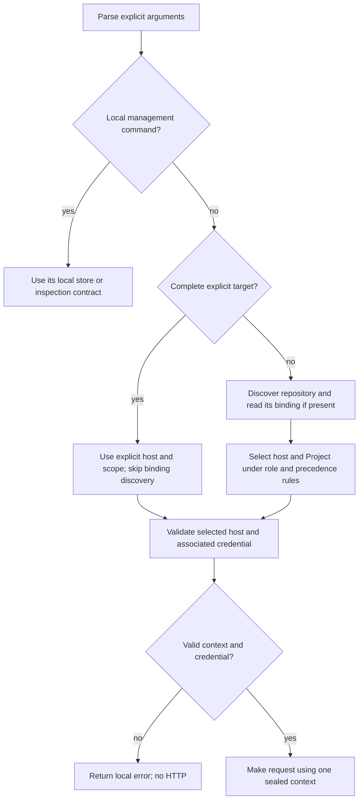

# Named CLI hosts and repository Project bindings

**Status:** Implemented and operator accepted

**Date:** 2026-09-30

**Updated:** 2026-10-16

## Purpose and approval scope

A user registers named Taskman hosts and binds each local Git clone to a host and Project.
Repository-scoped commands use that context by default; linked worktrees share it and independent
clones configure independently. Credentials stay in protected user configuration.

The complete written contract, D1–D23, is approved and implemented. The client workstream is
operator accepted; implementation and verification evidence is retained in repository-local
Beads delivery records `tas-zefk` and `tas-zefk.7`.

This client configuration work does not authorize replacing `br`, migrating tracker records,
changing execution or lifecycle authority, merging, publication, deployment, or changes to the primary
checkout or orchestration repository. Actual tracker replacement separately requires orchestration
to accept an execution/lifecycle contract and decide existing-record handling. Taskman remains an
HTTP client; a repository binding supplies context, not mutation authority.

## Decision inventory

| ID | Status | Decision or proposal | Downside or alternative | Rationale |
| --- | --- | --- | --- | --- |
| D1 | Accepted | Host and Project overrides must be supplied together for scoped commands using repository context. | Changing only the Project also requires repeating the host. | [Paired overrides](#paired-host-and-project-overrides) |
| D2 | Accepted | Schema migration: Read legacy configuration as host `default` without writes; explicit config mutation atomically upgrades the format. | Dedicated migration command makes writes explicit but adds setup friction; breaking rejection requires users to recreate credentials/config. | [Contract](#proposed-formats-and-migration-boundaries) |
| D3 | Accepted | Host commands are `config hosts add/show/list/set-key/remove` and `config default-host NAME`; registration stores no key and does not change the default. | Setup requires explicit credential/default steps; unauthenticated hosts cannot make API requests. | [Host registration and selection](#named-hosts-are-registered-through-the-cli) |
| D4 | Accepted | A repository binding takes precedence over environment host selection. | Environment endpoint settings cannot redirect commands in a bound repository; use explicit command overrides. | [Repository precedence](#repository-binding-outranks-environment-target-selection) |
| D5 | Accepted | Connections use named hosts; omit raw `--api-url` / `TASKMAN_API_URL` target overrides from the new interface. | One-off endpoints must be registered; existing raw URL callers need migration. | [Host registration and selection](#named-hosts-are-registered-through-the-cli) |
| D6 | Accepted | Search defaults to the bound Project; `--all-projects` searches the selected host, conflicts with `--project`, and allows host-only override. | Cross-Project discovery inside a bound repository requires the explicit escape flag. | [Search scope](#search-defaults-to-the-bound-project) |
| D7 | Accepted | Without a repository binding, named-host selection works and Project-required commands need explicit `--project`; repository binding commands require Git. No default Project or folder mapping. | Project flags remain necessary for work outside bound repositories. | [Unbound commands](#commands-without-a-repository-binding-use-explicit-projects) |
| D8 | Accepted | Use one clone binding shared by linked worktrees; omit persistent per-worktree overrides and use explicit selectors for exceptions. | Worktree-specific targets require repeated explicit flags. | [Contract](#approaches-within-the-accepted-storage-direction) |
| D9 | Accepted | Binding commands: `repo bind --host NAME --project ID`, `repo show`, `repo unbind`; verify Project through existing authenticated GET before binding. | Requires a reachable backend and credential; offline binding would persist unverified IDs. | [Contract](#proposed-resolution-and-command-boundaries) |
| D10 | Accepted | Removing a host leaves bindings intact; missing-host commands refuse locally without fallback. Re-registration of a name represents the same logical backend. | Clone references cannot all be discovered; recovery is manual and continuity is an operator assertion. | [Removal](#host-removal-leaves-repository-bindings-intact) |
| D11 | Accepted | Environment credential injection remains usable with a repository binding when it explicitly identifies the host the key belongs to. D12 defines named-host syntax and mismatch behavior. | Callers must identify the credential host as well as supply the secret. | [Host-associated credentials](#environment-credentials-identify-their-host) |
| D12 | Accepted | For a selected named host, pair `TASKMAN_API_KEY` with `TASKMAN_API_KEY_HOST`; use the key only when the host names match, otherwise refuse locally. | Existing unlabeled key injection needs an additional variable; a stale label causes refusal. | [Host-associated credentials](#environment-credentials-identify-their-host) |
| D13 | Accepted | Provide CLI host registration as well as repository binding; routine setup must not require hand-editing configuration. | Registration and binding remain distinct operations with different storage scopes. | [Host registration and selection](#named-hosts-are-registered-through-the-cli) |
| D14 | Accepted | `config hosts set-url NAME --url URL` changes the address of the same logical backend and preserves bindings; different backends get new host entries. | The operator must establish backend continuity; all repositories referencing the host follow the new address. | [Address changes](#set-url-changes-the-address-of-the-same-backend) |
| D15 | Accepted | Retain the stored key during a same-backend `set-url` change; the host name and credential association remain the same. | An incorrect continuity assertion can send the retained key to the wrong endpoint. | [Address changes](#set-url-changes-the-address-of-the-same-backend) |
| D16 | Accepted | Removing the default host clears its default selection atomically, with no automatic replacement; commands without any selected host refuse locally. | Commands outside bound repositories require explicit selection or a new configured default afterward. | [Default removal](#default-host-removal-clears-selection) |
| D17 | Accepted | Use `--host`, then repository host, `TASKMAN_HOST`, configured default; resolve host and credential once. | Context discovery needs Git unless the command supplies a complete target. | [Selection](#proposed-resolution-and-command-boundaries) |
| D18 | Accepted | Strict versioned JSON, lower-case host names, optional default and key with null equivalent to omission; reject unsafe or unknown state. | Manual files with unknown fields or invalid names require correction. | [Formats](#proposed-formats-and-migration-boundaries) |
| D19 | Accepted | Let Git discover working trees/common metadata; honor Git relocation variables and refuse uncertain discovery. | Missing Git or unfamiliar errors require explicit context or repair. | [Discovery](#git-discovers-the-shared-binding-location) |
| D20 | Accepted | Simple clone-local lock directory and atomic replacement, 100 retries at 100 ms, idempotent unbind; no new adversarial filesystem defenses. | Contention can wait about 10 seconds; interrupted writers leave manual cleanup, and post-replacement failures may already have changed state. | [Binding IO](#binding-validation-and-filesystem-failures) |
| D21 | Accepted | Local management/inspection and explicit receipt shapes below; no secret output or implicit host overwrite. | Local inspection cannot establish current backend identity or reachability. | [Commands](#named-hosts-are-registered-through-the-cli) |
| D22 | Accepted | Remove superseded commands/options from the registry; ordinary parser errors, no special handling. Refuse nonempty retired URL environment input. | Existing scripts need updating; generic argv errors supply no custom migration message, and old binaries cannot read upgraded files. | [Retired interfaces](#retired-command-and-environment-inputs) |
| D23 | Accepted | Preserve valid legacy partial settings, including the old localhost target for key-only files; empty state has no host. | Key-only import retains historical loopback semantics; no implicit loopback exists for fresh config. | [Legacy cases](#legacy-configuration-is-read-without-ordinary-command-writes) |

## Design baseline and provenance

Design research used source baseline `63b1b29725cd700f3a3250977f8c431b161c64ee`.
The unchanged source baseline passed `mix precommit`
with 1,209 tests passing and 32 excluded on local Elixir 1.20.2 / OTP 29. No authenticated backend
request or pinned release-runtime acceptance has been verified in this workstream.

Current contracts and implementation evidence:

- [Original API/CLI design](2026-08-29-api-cli-agent-skill-design.md) defines registry-driven
  commands, help, completion, output, and parity obligations.
- [Hosted access design](2026-09-02-authenticated-hosted-access-design.md#cli-authentication-and-configuration)
  adds protected configuration, the bearer credential, and authentication exit status 7.
- [Project identity design](2026-09-22-active-project-selector-design.md) and
  [directory removal design](2026-09-10-projects-without-primary-directories-design.md) establish
  machine-independent Project identity. Repository binding must not restore a server-side directory.
- [Global search](2026-09-29-global-task-search-design.md),
  [blocking relationships](2026-09-27-task-blocking-relationships-design.md), and
  [comments](2026-09-26-task-comments-design.md) extend the current operation surface.
- [Configuration source](../../lib/taskman/cli/config.ex),
  [configuration tests](../../test/taskman/cli/config_test.exs), and
  [config command tests](../../test/taskman/cli/commands/config_test.exs) establish actual persisted
  format, permissions, locking, atomic replacement, and precedence.
- [Parser](../../lib/taskman/cli/execution/parser.ex),
  [parser tests](../../test/taskman/cli/execution/parser_test.exs),
  [runner](../../lib/taskman/cli/execution/runner.ex), and
  [registry](../../lib/taskman/cli/registry.ex) establish syntax and dispatch boundaries.
- [Client](../../lib/taskman/cli/client.ex),
  [client tests](../../test/taskman/cli/client_test.exs), and
  [entrypoint tests](../../test/taskman/cli/entrypoint_test.exs) establish credential sealing,
  response validation, and exit semantics.
- [Bundled skill](../../priv/taskman_cli_skill/SKILL.md) owns agent usage guidance. Its current
  lifecycle and comment authority rules remain binding.
- External workstream provenance: the orchestration repository's capability comparison
  (`docs/research/taskman-br-capability-map.md`) and system-boundary decision
  (`docs/decisions/0002-system-of-record-boundaries.md`). These references do not grant permission
  to edit orchestration or override Taskman's product rules.
- Git's [rev-parse documentation](https://git-scm.com/docs/git-rev-parse#_options_for_files) describes
  absolute common-directory discovery and environment relocation;
  [repository layout](https://git-scm.com/docs/gitrepository-layout#Documentation/gitrepository-layout.txt-commondir)
  describes linked-worktree administrative state. The discovery command below follows
  those documented interfaces.

## Accepted requirements and exclusions

1. Protected user configuration supports multiple named Taskman hosts, each with its URL and
   credential. Credentials never live in repository metadata.
2. Each clone stores a local host plus Project ID binding in Git's common metadata directory,
   discovered through `git rev-parse --git-common-dir`. Linked worktrees inherit it.
3. Independent clones configure independently. Different users or clones may bind the same Git
   repository to different instances and Projects.
4. Bound Project supplies the default for scoped CLI commands. Explicit resource IDs continue
   to identify resources; names must not silently resolve ambiguously.
5. Endpoint and credential resolve together. Selecting one host must not silently reuse another
   host's key. For scoped commands using repository context, explicit host and Project overrides
   must be supplied together; see [D1](#paired-host-and-project-overrides).
6. No automatic Git URL association, server-side Git URL selectors, or committed root binding.
   A gitignored root-file-only binding was rejected because linked worktrees do not share it.
7. Record deletion is not required for initial replacement use. Done and Will Not Do suffice
   for retained records; this does not change who can authorize those lifecycle transitions.
8. Existing repeated status filters already provide OR semantics; omission includes every state.
   Whole-Project inventory continues to require `--include-descendants`.
9. Linked worktrees share one clone binding. Persistent per-worktree overrides are omitted
   in this increment; explicit command selectors cover exceptions (D8).

Excluded: product implementation during design, tracker migration, lifecycle-authority changes,
claim/assignment mechanisms, ready/blocked queues, broader search, new deletion operations, new
server association APIs, deployment, publication, and changes to the primary checkout or
orchestration documentation.

## Pre-implementation behavior and persistent-state inventory

| Owner | Baseline state and semantics | Design implication |
| --- | --- | --- |
| User config location | `${XDG_CONFIG_HOME:-$HOME/.config}/taskman/config.json`; empty variables fall back. | Keep one user-config authority and its existing test injection seams. |
| User config schema | JSON object with only optional string `api_url` and `api_key`; no version field. | Migration must cover missing, empty, URL-only, key-only, and complete files. |
| URL selection | `--api-url`, then `TASKMAN_API_URL`, then file, then `http://localhost:4000`. | D2 migrates stored settings; D5/D22 replace raw URL selectors. |
| Key selection | `TASKMAN_API_KEY`, then file; no credential argument. | Current independent resolution can send a stored key to an overridden URL; this behavior must change. |
| Protected paths | Config directory exactly 0700, file exactly 0600; regular file, one hard link; symlink rejection; opened-file identity checked. | Preserve existing confidentiality guarantees for every host and migration. |
| Writer coordination | `config.json.lock` directory, 0700, random `owner-TOKEN` file containing `taskman_config_lock_v1:TOKEN`; bounded retry, no lock stealing. | Migration and host edits must share the same lock and read-modify-write boundary. |
| Staged writes | Sibling `.config.json.stage-N`, exclusive creation, 0600, sync, rename, directory sync. | Preserve atomic replacement; failure after rename can mean the new contents are already present. |
| Git topology | Linked worktrees use a `.git` file; worktree administrative directory differs from common directory. | Never assume `.git` is a directory or place shared binding under worktree administrative metadata. |
| Repository binding | None currently. | New versioned local format and write/error semantics are required. |
| Parser | Explicit values only; required Project rejected before runner dispatch. | Defer contextual Project requirement until resolution; keep malformed explicit values a syntax error. |
| API | All `/api/v1` routes authenticate; resource routes revalidate Project scope. Search optionally accepts `project_id`. | No API change is needed to supply a CLI default. Server remains authoritative. |
| Transport | Runner seals resolved key; handlers pass resolved URL; client ignores untrusted auth/header/step injection except Req.Test adapter. | Resolve and seal URL and key as one context, with no lower-level endpoint substitution. |
| Installed skill | `~/.agents/skills/taskman-cli`, `.taskman-managed.json`, sibling stage/backup directories; source bundled at compile time. | Update source/help/onboarding/completions with the eventual CLI change; do not switch or relocate installed skills. |

No CLI resource cache, remembered Project, host selection state, or repository mapping database
was found in the inspected configuration and execution paths. Source build output, installed
escript, and installed skill are derived/versioned artifacts, not connection-setting authorities.
This inventory was derived from source and tests; no real credential contents were read.

Base URLs currently permit HTTP/HTTPS with a host, optional valid port, and empty or `/` path;
userinfo, query, fragment, and non-root paths are rejected. Keys use the existing complete-token
structural validation. These constraints should be preserved unless explicitly revised.

Current exit categories are 0 success; 2 local invocation/configuration failure; 3 API/domain
failure; 4 connectivity failure; 5 server/response or terminal-input failure; 6 skill installation
failure; 7 missing/rejected/forbidden authentication, including API rate limiting. Successful JSON
uses one `data` envelope on stdout; failed envelopes and diagnostics use stderr.


## Approaches within the accepted storage direction

**Accepted (D8): one shared clone binding plus command overrides.** Protected user JSON owns named
hosts; Git's common directory owns one host/Project reference. Scoped exceptions use explicit
`--host` and `--project`; environment selection cannot redirect a bound clone.

**Not included: persistent per-worktree overrides.** An additional file in worktree-specific Git
metadata would save repeated flags for recurring different targets, but introduces another format,
precedence layer, inspection source, and cleanup/rebinding behavior. The shared binding is sufficient
for now. Revisit only when repeated worktree-specific targets establish that need.

**Not selected: explicit context on every command.** This avoids repository state but fails the
accepted default-Project goal. It remains the escape path for unbound directories and one-off work.
A gitignored root-only binding was rejected because linked worktrees do not share it. Git URL
association, server-side directory fields, and a registry of all clones are excluded.

## Named hosts are registered through the CLI

D3/D13 make registration independent of repository binding and manual JSON editing. D21 specifies
these local command details. Every command below supports `--json`; none contacts the API.

| Command | State change / inspection |
| --- | --- |
| `config hosts add NAME --url URL` | Add a new host with no stored key. Duplicate names refuse; never overwrite an entry. Default and repository binding stay unchanged. |
| `config hosts list` | Stored hosts sorted by name, URL, stored-key boolean, and default marker. |
| `config hosts show NAME` | Inspect one stored host; unknown name refuses. |
| `config hosts set-key NAME` | Require the host to exist, prompt without echo, validate, then save its key. No key argument or key flag. |
| `config hosts set-url NAME --url URL` | Same-backend address change under D14/D15 below. |
| `config hosts remove NAME` | Remove the entry/key; if it was the default, clear that selection atomically. Unknown name refuses. |
| `config default-host NAME` | Explicitly select an existing host; unknown name refuses. |
| `config show [--host NAME]` | Inspect effective context and source labels offline; a missing selection is reportable, not an authentication error. |

A host after `add` has a name and validated URL, without a stored credential. Local inspection
works. API commands need either its stored key or correctly associated environment credentials;
otherwise they return status 7 and `authentication_required` before HTTP. A repository bind also
needs a credential for Project validation. Registration never creates a Project or selects a
default, including the first registered host. Automatic first-host selection would save a setup
step but implicitly change subsequent command targets.

For mutations, validate inputs and host existence, acquire the user-config lock, re-read current
state, and apply the change atomically. `set-key` checks existence before prompting, then rechecks
under the lock; do not hold the lock during terminal input. Failed input, duplicate names, unknown
hosts, or validation failures do not upgrade or change the file. A successful config mutation
writes version 2, including an explicit request that is a logical no-op. There is no host rename,
key argument, or key-clearing command in this increment. A key can be replaced with `set-key`;
removal/re-registration deletes it subject to the same-logical-host rule below.

`--host` is forbidden on host-management/default commands whose target is already named; it is
allowed on `config show`. Transport-selection environment settings are ignored by host management,
`repo show/unbind`, help/version, completion, onboarding, and skill installation. They must remain
usable for local recovery even when an injected credential pair is incomplete.

### `set-url` changes the address of the same backend

D14 accepts `taskman config hosts set-url personal --url URL` for the same logical backend.
It changes the user-config URL while preserving the host name, stored key (D15), default marker,
and repository bindings/Project IDs. No clone scan, binding rewrite, or remote identity check occurs.
Its success output explains that all repositories bound to that host follow the new address.

Backend continuity is the operator's assertion. A different backend must get a new named host and
explicit rebinding. A mistaken assertion can send the retained key to the wrong endpoint or give
Project IDs a different meaning. Immutable URLs would prevent that ambiguity but require new host
entries/rebinding for ordinary address changes; the operator accepted explicit `set-url` instead.
Clearing the key would force re-entry after a move and would not clear injected environment keys.

### Host removal leaves repository bindings intact

D10 removes the local host entry and stored key without scanning or editing clones. A domain
command relying on a binding to a missing host fails with status 2 and `invalid_configuration`,
before HTTP, with no fallback to environment/default. `repo show` can still report the binding
and `host_registered: false`. Recovery is explicit rebinding, unbinding, or re-registering the same
logical backend under its former name. A different backend requires a different name.

This relies on operator continuity for reused names and supports no registry, tombstone, or
binding generation. Different users of a Git repository use their own configuration and clones;
a single physical common directory has one shared binding, not a separate binding per user.

### Default-host removal clears selection

D16 clears `default_host` in the same atomic write when its host is removed. No replacement or
implicit localhost is selected. Other bindings and explicit/environment selectors still work.
If a domain command has no selected host, return status 2 and `invalid_invocation` before HTTP,
with guidance to select a host or configure a default. Local management/inspection remains usable.
This permits removing the last host; requiring a replacement first would add setup and need an
unset-default command just to remove the last entry.

## Proposed formats and migration boundaries

D18 retains `${XDG_CONFIG_HOME:-$HOME/.config}/taskman/config.json`. Empty XDG/home values use the
existing fallback behavior. Persist this version-2 object:

```json
{
  "version": 2,
  "default_host": "personal",
  "hosts": {
    "personal": {"api_url": "https://taskman.example.com"},
    "local": {"api_url": "http://localhost:4000"}
  }
}
```

Each host has required `api_url` and optional `api_key`. Credentials are deliberately omitted
from the example. Optional `api_key` and `default_host` accept omission or JSON `null` with
identical absent semantics. A non-null `default_host` must name an existing host. An empty host
map is valid. Required fields still reject omission or null; do not treat other invalid values as absent.
Reject non-objects, non-integer/unsupported versions, wrong field types, unknown fields, mixed
legacy/versioned state, invalid host entries, or a dangling stored default, with local
`invalid_configuration`. Do not discard unknown data or silently reset the file.

Host names match `[a-z][a-z0-9_-]{0,63}`: lower-case ASCII, case-sensitive, without trimming,
normalization, or path interpretation. `default` is an ordinary valid name, also used for legacy
import. URL and key validation retain the current Config rules: HTTP/HTTPS host, valid optional
port, empty or root path, no userinfo/query/fragment/outer whitespace; a stored key must match the
existing complete server-token pattern. Empty non-null stored URLs/keys are invalid. Different names may
have the same URL; never infer host identity or reuse a key by URL equality.

The clone binding is `<absolute-common-git-dir>/taskman/binding.json`:

```json
{"version": 1, "host": "personal", "project_id": 7}
```

Exact fields, version 1, a valid host name, and a positive integer Project ID are required. No URL,
credential, Git remote, absolute worktree path, Task ID, or lifecycle setting is stored. A missing
binding is unbound; malformed/unsupported existing data is an error, not absence. A valid binding
may have a dangling host reference after removal; D10 governs resolution/recovery.

### Legacy configuration is read without ordinary-command writes

D2 accepts reading legacy settings as virtual host `default`, without ordinary-command writes.
A successful explicit user-config mutation upgrades under the existing lock in one atomic write.
Only stored values participate: never persist environment overrides. `repo bind/unbind` modify
only the clone store and do not upgrade user configuration.

D23 accepts these partial-file semantics, preserving previously valid stored connections.
D18’s null-as-absence rule also applies to optional legacy `api_url`/`api_key`: normalize null to
absence before applying the cases below, so a file with only null settings is equivalent to `{}`:

| Stored legacy state | Effective named configuration |
| --- | --- |
| No file, or `{}` | Empty hosts, no default; no implicit endpoint. |
| Valid `api_url` only | Host `default` at that URL, no key, selected as default. |
| Valid `api_key` only | Host `default` at the old `http://localhost:4000` endpoint, with that stored key and selected default. |
| Valid URL and key | Host `default` with those values and selected default. |
| Empty/invalid stored value, malformed JSON, wrong type, unknown field, mixed format | Local refusal, unchanged file. |

Key-only import preserves the legacy resolved localhost target; it is not a fresh-config fallback.
Explicitly selecting the virtual `default` host or storing a repository reference to it works
before upgrade. Adding `default` to nonempty legacy state is a duplicate-name error; choose another
name. Upgrade preserves the old connection/default while applying the requested mutation.
Failed mutations leave legacy bytes untouched before replacement; filesystem failures after
replacement have the mutation uncertainty described below.

### Retired command and environment inputs

D5 selects named hosts; D22 accepts removal of superseded argv interfaces without special handling:

- Remove `--api-url` (including inline form), `config set-url`, and unqualified `config set-key`
  from the command/option definitions. The ordinary parser rejects them as unknown/invalid
  invocation, with status 2 and `invalid_invocation`, using its normal wording and applicable help.
  Do not add detection branches, aliases, compatibility handlers, or custom migration messages.
  No prompt or write occurs, just as for other invalid invocations.
- Nonempty `TASKMAN_API_URL` on domain, bind, or effective-context inspection commands still
  returns status 2 and `invalid_configuration`, with guidance to replace it with named-host
  selection. Local management/recovery ignores it under the isolation rule above. Empty is absent.
  This environment rule is separate from ordinary unknown-command/option parsing.

No compatibility writer guesses a host from a repository/default. Stored legacy-file reading is
supported, old invocation syntax is not. Old CLI binaries reject the new file format; update the
binary before the first new config write. There is no automatic downgrade or cross-binary writer
compatibility promise.

## Proposed resolution and command boundaries

D17 uses global `--host NAME` (before/after the command, inline form supported), environment
`TASKMAN_HOST`, then existing configuration. Preserve current non-repeatable option semantics:
the last explicit occurrence wins, and every provided value must be syntactically valid. There
is no Project environment variable or user-level default Project.

Host selection is `--host` > repository binding > nonempty `TASKMAN_HOST` > configured default.
Missing selection follows D16. A selected unknown host is `invalid_configuration`, never a reason
to fall through. Empty environment selectors are absent; invalid losing `TASKMAN_HOST` values
are ignored when an explicit host or repository binding wins. Explicit empty/invalid host flags
are invocation errors. Validate the full user file before selecting any stored host.

Resolve once into a sealed snapshot containing host name, URL, credential, optional Project ID,
and safe source labels. Runner supplies endpoint and key together through the resolved runtime
channel (also used for bind validation). Client must not choose a localhost default or accept an
unresolved endpoint/key substitution from request options; preserve only the allowed Req.Test
transport seam. Resource handlers consume the snapshot and never resolve defaults again. The server retains resource scope and lifecycle authority.

Registry metadata distinguishes:

| Role | Commands / Project behavior |
| --- | --- |
| Required Project context | All Lists commands and all Tasks commands except search: explicit or bound Project required. |
| Optional Project filter | Tasks search: inherits Project when bound, unless `--all-projects`; explicit filter allowed when unbound. |
| Host only | Projects list/create and Projects show/update with their explicit positional IDs; no bound Project substitution. |
| Explicit bind | `repo bind --host NAME --project ID` never inherits missing selectors. |
| Local management / inspection | No API authentication; target/inspection rules in the command and output sections. |

Parser work is environment/filesystem-free. Keep explicit provenance, validate malformed supplied
IDs/options immediately, and defer contextual Project requirements to the resolver. Never infer
roles merely from an option called `project`.

Ordinary domain-request flow; bind and local inspection follow their dedicated contracts.



A complete explicit target is required-context commands with both `--host/--project`, search with
both or with `--host/--all-projects`, or host-only commands with `--host`. These skip Git and the
binding entirely, providing recovery from stale/malformed binding state or missing Git. Partial
search overrides require discovery to distinguish bound-Project defaults from unbound global
search. A required-context command with explicit `--host` but no Project can fail for missing
`--project` without discovering Git; it must never inherit a Project implicitly.

### Paired host and Project overrides

D1 requires both explicit selectors when overriding a bound Project context, even if their values
match the binding. With neither selector, use the bound pair. With both, use the explicit pair.
A half-pair is status 2 and `invalid_invocation`, before HTTP, with no binding change.

| In a clone bound to personal Project 7 | Outcome |
| --- | --- |
| `tasks list` | Personal Project 7. |
| `tasks list --host work` | Refuse: also supply `--project`. |
| `tasks list --project 9` | Refuse: also supply `--host`. |
| `tasks list --host personal` | Refuse: also supply `--project`, even for the same host. |
| `tasks list --host work --project 9` | Work Project 9. |

The asymmetric alternative only required a Project for a different host; the accepted symmetric
rule also makes a same-host Project change explicit. Host-only commands are exempt because they
inherit no Project ID. Complete explicit context also bypasses a dangling binding reference.

### Repository binding outranks environment target selection

D4 keeps bound context predictable across terminals. A shell selecting work does not redirect a
clone bound to personal Project 7. Explicit overrides remain available. Environment-first selection
would be convenient for job-wide redirection but make targets depend on inherited shell state.
Environment selection remains useful for unbound clones, fresh CI checkouts, and non-Git folders;
bindings are clone-local metadata, not committed source. D17 completes the fallback order above.

Inspection on 2026-10-14 found no checked-in use of Taskman URL/key environment settings in this
repository's `.github/` or `ops/` scripts, nor orchestration scripts; its matches were documentation.
Current use is in tests and CI/container guidance in [onboarding](../../lib/taskman/cli/onboarding.ex)
and the [bundled skill](../../priv/taskman_cli_skill/SKILL.md). Ad hoc shells/external CI were not
inspected; real configuration, credential files, and environment values were not read.

### Environment credentials identify their host

D11/D12 use `TASKMAN_API_KEY` with `TASKMAN_API_KEY_HOST`. The label associates the key with the
selected named host and never selects an endpoint or Project. A matching injected key overrides
the stored key. An incomplete or mismatched pair returns status 2 and `invalid_configuration`,
before HTTP, without stored-key fallback or credential output. URL equality between aliases does
not count as a name match. This supports secret injection without storing the key locally, at the
cost of an additional variable.

D17 accepts exact empty/orphan handling: empty strings are absent; both absent/empty use the
stored key, or status 7 if an API request has no key. Exactly one nonempty variable is a local
configuration error, including a host label without a key. Validate the nonempty key with the
existing token rule and host label with D18, without showing either raw injected value in errors.
On `config show` with no selected host, a structurally valid complete pair is not applied and
reports no configured effective key. Credential validation never contacts the API. Local
management ignores these variables as described above.

### Search defaults to the bound Project

D6 scopes `tasks search QUERY` to the bound Project. `--all-projects` suppresses that filter on the
selected host; it does not change host selection or backend search behavior. `--all-projects` and
`--project` conflict with status 2 and `invalid_invocation`. `--host work --all-projects` is host-only
and does not need a Project flag. The browser's global search/API filtering remain unchanged.

| Bound to personal Project 7 | Target |
| --- | --- |
| `tasks search publish` | Personal Project 7. |
| `tasks search publish --all-projects` | All Projects on personal. |
| `tasks search publish --host personal --project 9` | Personal Project 9. |
| `tasks search publish --project 9` | Local half-pair refusal. |
| `tasks search publish --host work --all-projects` | All Projects on work, no inherited Project. |
| `tasks search publish --all-projects --project 9` | Local conflicting-scope refusal. |

The global-default alternative preserved current behavior and ease of cross-Project discovery;
the operator selected repository context, with explicit global escape to avoid hiding that capability.

### Commands without a repository binding use explicit Projects

D7 permits named-host selection in unbound Git repositories/non-Git folders. Project-required
commands need explicit `--project`, otherwise local status 2 and `invalid_invocation`. The host may
come from the configured/environment default without a separate `--host`; D1 only couples overrides
of a bound context. Unbound search remains global unless explicitly filtered. No user-level default
Project or non-Git folder mapping is introduced; these add another context authority and can target
an unrelated Project after a directory change. Repeating Project flags is the accepted cost.

Projects show/update keep their positional IDs. Bound Project is the blocker Task's Project for
block edits/inspection; the target Task may be in another Project on the same selected host.
Project list/create choose a host but never consume a bound Project ID.

## Git discovers the shared binding location

D19 accepts argv-based calls from the invocation working directory (injected in tests):

```text
git rev-parse --is-inside-work-tree
git rev-parse --path-format=absolute --git-common-dir
```

Use `LC_ALL=C` for predictable classification and capture diagnostics internally. Honor normal
Git repository relocation/discovery variables, including `GIT_DIR`, `GIT_WORK_TREE`,
`GIT_COMMON_DIR`, and ceiling/filesystem settings; the binding follows the repository selected by
Git. Do not parse `.git` files or Git remotes. Root/subdirectories, linked worktrees, detached HEAD,
and paths with spaces work. A nested repository/submodule has its own binding; never search an
outer repository after discovering the nearer one is unbound.

These commands and common-directory behavior are documented by
[Git rev-parse](https://git-scm.com/docs/git-rev-parse#_options_for_files) and
[repository layout](https://git-scm.com/docs/gitrepository-layout#Documentation/gitrepository-layout.txt-commondir).
Temporary local fixtures on Git 2.56.0 reproduced: clone/linked worktree `true` with the same absolute
common path; bare repository `false`; non-Git status 128 with the normal parent-discovery diagnostic;
broken gitfile status 128 with a different fatal diagnostic. Exit 128 alone cannot mean unbound.

| Discovery result | Contract |
| --- | --- |
| Exit 0, exact `true` | Resolve absolute common directory; require one nonempty absolute path. |
| Exit 0, exact `false` | No working-tree binding; domain commands act unbound; repo commands refuse. |
| Exit 128, first C-locale fatal diagnostic starts `fatal: not a git repository (or any ` | Ordinary non-Git location; domain commands act unbound; repo commands refuse. |
| Missing Git, unsupported output, other failure, malformed gitfile, unreadable common directory | Status 2, `invalid_configuration`; do not fall back to another context. |

The diagnostic distinction is an observed Git behavior, not a documented stable error protocol.
The documented `rev-parse` discovery interface does not specify a distinct machine-readable
reason for ordinary non-Git versus broken-repository failures; `--quiet` only applies to object
verification with `--verify`, not discovery. Retain the C-locale diagnostic classification here.
Unfamiliar diagnostics safely refuse. Git must support the specified flags; no automatic fallback
path parser is added. Paths containing line breaks are unsupported by this single-path output
contract. Complete explicit targets and host management can work without Git under D17.
`repo bind/show/unbind` always require an available working tree; outside/bare locations return
status 2 and `invalid_invocation`. Git discovery failure/unavailability is `invalid_configuration`.

## Binding validation and filesystem failures

D9 requires `repo bind --host NAME --project ID` with both selectors and authenticated
`GET /api/v1/projects/:id` before writing. Use the existing Client member-Project response contract;
D20 additionally requires the returned ID to equal the requested ID (otherwise status 5,
`invalid_response`). Missing Project, authentication/connection failure, or invalid response leaves
the previous binding unchanged. No offline bind, implicit Project creation, or automatic retry.

D20 accepts a simple cooperative-writer design for a trusted local filesystem:

- Preserve the existing user-config protections and atomic write implementation. Its current
  permission/link/opened-file checks and lock owner marker already protect stored credentials;
  do not extend that adversarial machinery to the new binding store. Read-only commands create
  no files. User-config and binding locks both use 100 retries at 100 ms intervals (about 10 seconds
  of waiting); no lock stealing. Migration/host changes remain a locked read-modify-write.
- Create only `<common-dir>/taskman/` with mode 0700 and new binding/staging files with mode 0600.
  Never chmod Git's common directory. Use ordinary directory/file IO and schema validation;
  filesystem failures return local errors. No binding inode/opened-identity comparison, hard-link
  checks, strict existing-mode enforcement, symlink defense, ownership-token protocol, or other
  TOCTOU/adversarial-path protection is required. This assumes operators do not redirect or replace
  managed paths while commands run; it is not protection against a hostile same-user process.
- Acquire the binding lock by atomically creating sibling directory `binding.json.lock`; an
  existing directory means contention. Track only whether this invocation acquired it, and
  attempt to remove it on exit only in that case. Do not add owner-marker files, lock verification
  handshakes or recursive lock removal. Interrupted writers can leave a stale lock.
- Stage a unique sibling `.binding.json.stage-N` using exclusive creation, write complete JSON,
  sync the file, rename it over the binding, then sync the parent. Use straightforward filesystem
  primitives; avoid a generic protected-store framework. Attempt cleanup of this invocation's
  temporary file on failure. Binding readers need no lock and see complete old or new JSON.
- Bind reads existing state and selects the explicit host/key, validates remotely, then acquires
  the binding lock and re-reads current binding state before replacement. Do not hold the lock
  across HTTP. Concurrent successful binds serialize; the last replacement wins. No cross-store/
  server transaction or repeated GET is promised. The Project can later disappear; future API
  calls remain authoritative.
- `repo unbind` is offline and idempotent. If the Taskman directory is absent, succeed without
  creating it. Otherwise acquire the binding lock, remove the binding if present, then sync the
  directory. It can remove malformed/unsupported JSON without parsing it, providing explicit
  repair. Ordinary IO failures refuse; leave the directory itself. No config migration, host
  removal, API call or credential requirement occurs.
- Failed bind validation changes no binding. A write failure before replacement preserves it;
  a failure after rename/directory sync or unbind removal may already have changed it. Return
  local status 2 and `invalid_configuration`, explaining possible mutation and `repo show`
  inspection; never claim rollback.
- Interrupted writers may leave lock/staging files. No automatic lock stealing, orphan scanning,
  rollback or recovery service. Reads remain possible when a stale lock blocks writes; after
  verifying no writer is active, the operator can remove the identified stale artifacts.

A malformed binding blocks context-dependent commands even when a default host exists. Complete
explicit commands bypass it under D17. `repo bind` refuses malformed existing binding state;
explicit `repo unbind` followed by bind is the recovery. Removal/name reuse and same-backend URL
changes retain the operator-continuity boundary in D10/D14; no remote identity service is added.

## Inspection, output, and local errors

D21 preserves one newline-terminated `data` envelope on stdout for JSON success, one `error`
envelope on stderr on failure, and no failure stdout. Readable parser errors retain
`Invalid invocation: MESSAGE.` followed by command help; handler/configuration errors retain
`Error: MESSAGE (CODE)` with safe remediation. Never print keys or configuration contents.
HTTP resource success shapes and existing API error categories stay unchanged. Help remains
readable text; JSON data and receipt support does not introduce a serialized-help contract.

| Command | JSON `data` shape |
| --- | --- |
| Host add/set-key/default-host | `{"saved":true}` |
| Host set-url | `{"saved":true,"message":"All repositories bound to this host use the updated URL. API key retained."}` |
| Host remove | `{"removed":true}` |
| Host list | Array of host descriptors, sorted by name. |
| Host show | `{"name":"personal","api_url":"https://taskman.example.com","api_key_configured":false,"default":true}` |
| Repo bind | `{"bound":true,"host":"personal","project_id":7}` |
| Repo unbind | `{"unbound":true}`, including already-unbound state. |
| Repo show | `{"common_git_dir":"/absolute/common","binding":{"host":"personal","project_id":7},"host_registered":true}`; binding null when absent, registration null when absent. |

`repo show` reads the binding offline and, when a binding exists, checks host existence through
protected user config without credential resolution/authentication. With no binding, it need not
read user config. Missing config reports a dangling reference;
malformed/unsafe user config refuses inspection. It does not prove current backend/Project identity.
`config hosts list/show` describe stored keys only, ignoring environment injection. `config show`
shows effective context with keys limited to:

```json
{"data":{"config_format":"v2","default_host":"personal","host":"personal",
"api_url":"https://taskman.example.com","api_key_configured":false,"project_id":7,
"sources":{"host":"repository","project":"repository","key":"none"}}}
```

`config_format` is `absent`, `legacy`, or `v2`. No selected host means host/URL/Project null, key
configured false, and sources `none`. Otherwise host source is `flag`, `repository`, `environment`,
or `default`; Project source is `repository` only when the binding supplies the selected context,
else `none`; key source is `stored`, `environment`, or `none`. Explicit `config show --host NAME`
inspects that host with no inherited Project, even if the name matches. It accepts no `--project`.
A missing bound host is an error for effective inspection, while `repo show` can expose that reference.

Readable host inspection uses name/URL/`configured` or `not configured`/default marker; repo
inspection includes common directory, stored host/Project or `unbound`, and registration status.
Mutation messages report the changed local state; set-url includes the exact scope message above.
Local error wording can be concise, but status/code, no-secret output, and remediation are contracts:

| Condition | Exit / code |
| --- | --- |
| Malformed argv/IDs/names; conflicting search flags; missing required host/Project; named-management unknown/duplicate host; repo command outside working tree; retired argv | 2 / `invalid_invocation` |
| Invalid config/binding or unsafe user-config paths; selected missing host; Git discovery failure; retired URL environment; bad injected pair; busy lock or local IO failure | 2 / `invalid_configuration` |
| Selected API context has no credential | 7 / `authentication_required` |
| Secret prompt unavailable | 5 / `input_unavailable` |
| GET response ID differs from requested Project | 5 / `invalid_response` |

Parse/constraint errors precede IO. Then validate config/discovery/context, then credential,
then HTTP; ambiguity in combinations of independent local errors does not authorize any request.
Error messages may identify safe paths/selected host names, never raw injected values, key bytes,
or file/HTTP contents. Status 3 domain, 4 connectivity, 5 response/server, 6 skill installation,
and 7 API authentication/rate-limit categories retain current semantics. No automatic rebinding,
credential guessing, or clearing stale Project references on an HTTP error.

## Implementation responsibilities

The implementation is client-only; API controllers, domain schemas and database migrations are unchanged.

- `lib/taskman/cli/config/document.ex`: pure host schema validation, legacy projection and v2
  encoding. `config.ex` owns protected file IO, locks and host mutations. The credential store's
  protections remain distinct from cooperative binding IO.
- `repository_binding.ex`: Git discovery, shared binding schema and ordinary lock/stage/sync/rename
  IO. `context.ex` owns command-role selection, provenance, paired scope and credential association.
- Registry, `registry/command.ex` and parser own paths, usage, options, constraints and context roles;
  parsing performs no config IO. Registry owns contextual usage strings, so Help does not rewrite
  command syntax. Global restrictions use only `{:forbid_global, [fields]}`; discovery consumers
  share `Command.forbidden_global?/2`.
- Runner prepares context once from the command role before dispatch, seals endpoint/key and
  supplies the resolved Project. Local Config/Repo commands snapshot their storage environment;
  utilities keep their supplied runtime options without context resolution. Client consumes the
  sealed endpoint/key and owns HTTP execution and response validation.
- Local Config/Repo handlers own management, prompting, inspection, bind validation and receipts.
  Resource handlers own HTTP payloads and resolved scope. `Execution.Result` shares narrow result
  construction; `Presentation.Output` owns resource/error rendering. Commands retain their local
  data and readable text; no generic command/store framework is needed.
- Help, Bash/Fish completions, onboarding, README and the bundled skill provide command,
  environment, migration and recovery guidance. The bundled skill retains lifecycle/comment authority.
- Tests use disposable config/Git/skill roots and per-call cwd/environment. Runtime options accept
  a map or keyword list; an injected environment is authoritative for Git discovery too. Shared
  fixtures live in `test/support/fixtures/cli_fixtures.ex`. Small wait/rename/directory-sync seams
  test distinct IO boundaries; they are not public tuning flags or an adversarial filesystem adapter.

## Verification strategy and review evidence

1. Version/host-name/schema validation and every legacy row, including null/omitted optional
   fields and invalid null required fields; ordinary reads leave bytes unchanged;
   successful locked mutation upgrades without environment copying or lost unrelated hosts.
2. Context matrix: explicit/repository/environment/default/no-host; complete bypass and partial
   refusal; same-value explicit flags; ignored losing selector; selected missing host; malformed
   binding; stored/injected/no key; empty/orphan pairs; raw input retirement. Zero HTTP on local errors.
3. Public CLI read/mutation using a bound Project; search defaults/escape/conflict/host-only override;
   set-url retains key/bindings and explains scope; default removal and explicit dangling recovery.
4. Real Git fixtures for root/subdirectory, linked worktree sharing, independent clone isolation,
   detached HEAD, spaces, nested repository/submodule, bare/non-Git, relocation variables, missing
   Git, malformed gitfile, and unsupported diagnostics. No Cartesian product of incidental variants.
5. Preserve existing protected user-config coverage. Verify binding creation modes, ordinary IO
   failures, concurrent writers, 100 × 100 ms retry bounds, acquisition-gated lock release,
   stage/rename/sync failures, idempotent unbind, malformed-binding repair, and post-replacement/
   removal failures. No adversarial binding-path/identity test matrix. Show persisted state;
   never assert rollback after commit.
6. JSON/readable inspection and receipts, redaction across success/error/prompt paths, registry/help/
   completions/onboarding/bundled skill parity, and rebuilt escript feature parity. Keep lifecycle
   authority unchanged. Native prompt acceptance is required if the shared prompt implementation changes.
7. Run `mix precommit`, focused CLI tests and the rebuilt executable gate documented in the
   [development guide](../guides/development.md#cli-verification). Local success does not establish
   pinned release-runtime acceptance. Documentation checks cover local links/anchors, whitespace,
   decision statuses, source fidelity and preservation of outstanding commitments.

Git documentation and disposable fixture evidence establish discovery behavior for Git 2.56.0;
other diagnostics may safely refuse. No live authenticated backend was exercised. Trusted operator
continuity is an accepted limitation for endpoint changes/name reuse, not a technical identity proof.

## Verification result and limits

Independent scoped verification found no blocking defect against D1–D23 or the subsequent
behavior-preserving simplifications. At source `b1258a70`, the CLI suite passed 289 tests (three
explicit external-artifact skips), `mix precommit` passed 1,273 tests (three artifact skips,
32 browser exclusions), and the rebuilt actual escript passed all three smoke tests without skips.
Detailed requirement mapping, seeds and review evidence belong to `tas-zefk.7`; reusable gate
commands belong to the development guide.

Evidence uses local Elixir 1.20.2 / OTP 29 / ERTS 17.0.3 and Git 2.56.0. Pinned release/Alpine,
browser, live authenticated backend and native deployment acceptance remain unverified. Production
prompt code was unchanged, so this increment did not trigger native-terminal prompt acceptance.
Staged `IO.binwrite` and `:file.sync` failures were not directly injected; checked pre-rename flow
and distinct persisted-state boundary tests support the accepted cooperative IO guarantee, with
no rollback promise after replacement/removal. The unrelated intermittent global-search recovery
selector failure remains unresolved in `tas-n9pb`; passing reruns do not establish a fix.
