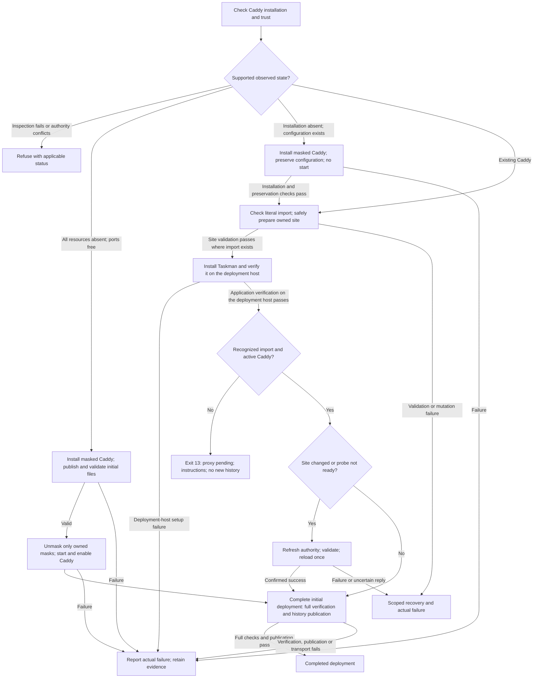
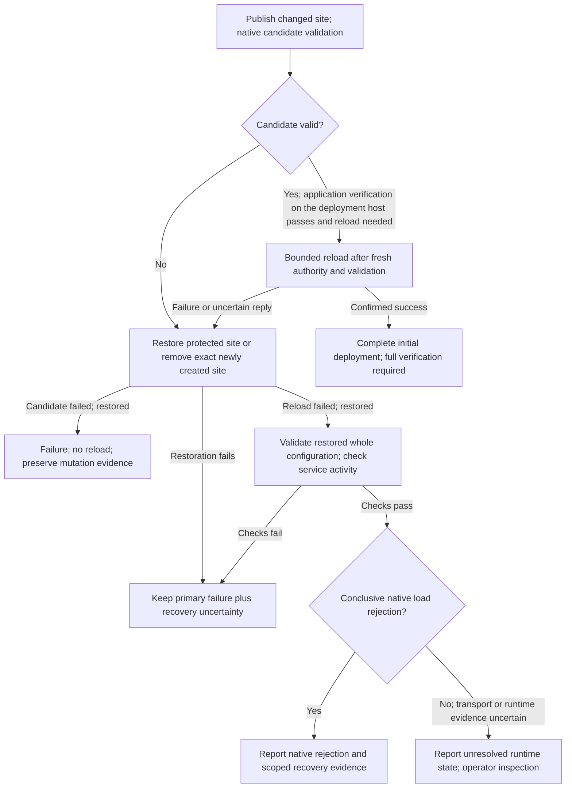

# Caddy provisioning with operator-owned configuration

Status: approved written specification and implementation plan; implementation and local corrections complete.
Dated native results/restoration accepted. New native actions, production provisioning and publication remain separately gated.
Workstream: `shared-host-deployment`; Beads: `tas-lny6.3`. Updated: 2026-10-07.

## Purpose and accepted direction

Provision Taskman on a host that already runs Caddy without taking ownership of the host's
proxy configuration or existing applications. Retain complete Caddy provisioning on a new host.
The operator selected these behaviors:

- Existing **Caddy**, regardless of Taskman's installation state: create/manage only Taskman's
  site file. Recognize an existing compatible glob import with a narrow grep-style check;
  provide import directions when it is missing. When the glob exists, use native full-configuration
  validation and automatic reload after a changed site. Do not fully parse or rewrite existing
  configuration in controller code.
- Absent Caddy with no existing configuration: install and configure the proxy completely, then
  start and enable the validated service.
- Caddy configuration exists but Caddy is not installed: install Caddy without replacing that
  configuration or starting the service, then follow the existing-Caddy rules.
- Existing Caddy with an unactivated Taskman site: finish installing Taskman and report proxy
  activation as pending. Do not stop application installation merely because an import is needed.

### Provisioning decision summary

The scenario tables below summarize behavior; the linked sections define the full contracts.

#### Decision inventory

| ID | Status | Choice and rationale | Operator cost or limit |
| --- | --- | --- | --- |
| D1 | Accepted | [Operator-owned main Caddyfile and other site files](#existing-caddy-classification-and-service-limits) | Operator adds missing import |
| D2 | Accepted | [Full absent-Caddy provisioning](#absent-caddy-required-evidence-and-leftover-files) | Initial package/main/service mutation |
| D3 | Accepted | [Deployment-host setup without an import](#pending-branch-selection) | Host readiness is not public completion |
| D4 | Accepted | [Grep permits native validation/reload](#meaning-and-limitations-of-a-match) | Match proves neither structure nor loaded state |
| D5 | Accepted | [Site-only reruns](#reruns-and-dedicated-hosts) | Manual interrupted-bootstrap completion |
| D6 | Accepted | [Fixed minimal site and strict authority](#site-destination-and-supported-topology) | No custom directory or multiple installations |
| D7 | Accepted | [Bounded literal-import recognition](#supported-literal-forms) | Equivalent layouts can need manual activation |
| D8 | Accepted | [Persistent installation masks](#new-host-package-installation-and-service-masks) | Failed bootstrap needs manual mask repair |
| D9 | Accepted | [Site-only publication and recovery](#scoped-rollback-and-uncertain-runtime-state) | Disk changes before validation; runtime uncertainty |
| D10 | Accepted | [Quiescent activation window](#diskruntime-transition-and-coordination-limits) | Operator coordination; no host-wide lock |
| D11 | Accepted | [Separate setup on the deployment host](#internal-preparation-operation-and-shared-lifecycle) | Helper/protocol work and two-phase orchestration |
| D12 | Accepted | [Conditional reload](#automatic-activation-after-local-proof) | Failed advisory probe can cause needless reload |
| D13 | Accepted | [Nonzero pending and exact-target finalization](#pending-output-and-mutation-evidence) | Nonzero needs pending handling; first-selection backups and deploy wait |
| D14 | Accepted | [Observed plans and authority refresh](#preview-contract-and-dry-run-behavior) | Drift needs new preview |
| D15 | Accepted | [Disk-backed configuration](#rejected-approaches-and-allowed-native-parsing) | Custom API policies need operator procedures |
| D23 | Accepted | [Install missing Caddy; preserve configuration](#absent-caddy-required-evidence-and-leftover-files) | Service activation remains manual |
| D24 | Accepted | [Trust authenticated stable packages; bind each installation run](#authenticated-stable-package-selection) | Upstream scripts can change host state; preservation failure may be detected after mutation |
| D21 | Rejected | [Main-file insertion/parsing/managed blocks](#rejected-approaches-and-allowed-native-parsing) | Would interpret or own operator configuration |
| D22 | Rejected | [Import-required admission](#rejected-approaches-and-allowed-native-parsing) | Would prevent requested deployment-host setup |

#### Normal and boundary scenarios

All existing-Caddy rows assume passing Caddy installation and trust checks under
[Existing Caddy: classification and service limits](#existing-caddy-classification-and-service-limits),
and application verification on the deployment host under
[Request, result and advisory public probe](#request-result-and-advisory-public-probe).
Failures remain failures; the pending result is not a fallback for failed application preparation.

| Input state | Proxy action | Observable result |
| --- | --- | --- |
| Existing; recognized import; active and unmasked; site changed | Native validation, one reload after setup on the deployment host | Full deployment verification must pass before completed exit 0 and history publication |
| Existing; recognized import; active and unmasked; unchanged site and `public_probe: ready` | Validate; skip reload and preserve site mtime | Full deployment verification still establishes completion |
| Existing; no recognized import | Publish owned site; no reload; give exact import directions | Exit 13, `application-provisioned-proxy-pending`; no new successful history |
| Existing; recognized import; inactive or masked | Validate site/configuration; operator activates service | Same pending stage; no start, enable, unmask or restart |
| All Caddy resources positively absent; no 80/443 listeners | Signed installation, persistent masks, initial main import and site; validate, start and enable | Complete provisioning and full deployment verification |
| Caddy configuration exists, but Caddy is not installed | Install without replacing configuration or starting Caddy; continue site-only setup | Exit 13 after application verification on the deployment host, proxy pending; operator validates/activates service |

#### Failure and retry scenarios

| Input or failure | Surviving state and recovery | Observable result |
| --- | --- | --- |
| Read/grep fails or main exceeds 64 KiB | Do not reinterpret failure as absence or a missing import | Inspection exit 5 |
| Recognized import; existing complete configuration already invalid | Refuse before site mutation; no reload | Caddy validation exit 8 |
| Published candidate fails native validation | Restore old site, or remove only the exact newly created owned site; no reload | Exit 8; retain changed/recovery evidence |
| Reload fails or its reply is lost | Restore site on disk and check restored configuration/service; no restart or blind retry | Activation failure; primary error retained; runtime uncertainty explicit where evidence is unavailable |
| Full deployment verification or history publication fails after reload | Retain installed application/recovery state; no fabricated completion | Actual failure report/status, not pending exit 13 |
| Installation stops after package creation but before main configuration | Retain created masks; next invocation sees existing Caddy | Site-only preparation and manual proxy completion |
| Installation over preserved configuration fails or changes the original main unexpectedly | Keep masks and protected preservation evidence; operator resolves installation/configuration | Actual installation failure, not a pending result |
| Operator adds import, activates Caddy, then reruns the retained target | Validate/reload if needed, then complete initial deployment | First successful selection publishes only after full deployment verification |
| Owned authority or import predicate changes after confirmation | Stop for a new preview | Drift exit 10 |

#### Provisioning and completion flow

This diagram omits detailed file checks and scoped recovery; those remain mandatory in their
contract sections. “Active” below means active, unmasked, supported Caddy.



### Approval and authorization gates

D1–D15 and D23 are accepted decisions; D16–D20 are inherited constraints.
D21–D22 are rejected. The complete written specification, including D13’s exact controller code
and existing JSON status mapping, is approved. Local implementation, independent verification
and bounded native acceptance are complete.

Written-specification approval alone permits planning. Approved implementation planning and execution
authorize the local implementation scope; neither technical readiness nor local commits authorize
host changes. Native acceptance/host mutation, production provisioning and publication each need
separate authorization. Private work and history remain protected under D20.

## Context and authority

### Canonical sources and scope

This design changes only the Caddy boundary and the application-preparation result needed for
pending proxy activation. The inherited constraints below remain accepted; changes require revision
of their authoritative contracts, rather than an exception to simplify this increment.

| ID | Status | Inherited constraint and authority |
| --- | --- | --- |
| D16 | Accepted | Full deployment verification gates successful history; see [verification contracts](#existing-verification-and-version-contracts) and [operations contracts](2026-09-18-operations-contracts.md). Application verification on the deployment host cannot finalize installation. |
| D17 | Accepted | Keep the existing checks for supported host platforms, trusted Caddy installations, and supported service/network arrangements, as defined in the [deployment architecture](2026-09-09-dedicated-host-deployment-design.md) and [classification limits](#existing-caddy-classification-and-service-limits). Refuse provisioning when those checks fail. |
| D18 | Accepted | Preserve application/data, provenance, migration recovery, mutation/failure evidence and secret safety in [operations contracts](2026-09-18-operations-contracts.md). Recovery must not delete or reinitialize application data, or take ownership of unrelated configuration. |
| D19 | Accepted | Add the new internal operation without changing existing operation contracts, protocol versions, public output schemas or persisted-record formats, as defined in [operations contracts](2026-09-18-operations-contracts.md) and [protocol compatibility](#verification-boundary-and-protocol-compatibility). |
| D20 | Accepted | Keep real deployment-host and workstation details in encrypted deployment configuration and private operator records, never readable public files. Public documentation uses generic examples under the [inventory privacy policy](../inventories/operations-environments.md); external actions retain the [authorization gates](#approval-and-authorization-gates). |

Read the architecture's component ownership, provisioning and verification sections and operations
contracts' unfinished-first-installation, record-publication, admission, protocol and mutation/failure
sections. The [runbook](../guides/deployment.md) owns procedures; the
[development guide](../guides/development.md#operations-verification) owns verification commands.

### Observed host and privacy boundary

A supported existing installation has operator-owned configuration and unrelated sites or services.
The design preserves those resources and validates Taskman's own site against the full native
configuration. Actual installation inventories, account details and observations belong in private
operator storage; the [inventory privacy policy](../inventories/operations-environments.md) defines
that boundary. Examples here describe supported arrangements, not a recorded deployment machine.

### Current implementation gaps

Read-only repository inspection on 2026-10-02 established the following design-time gaps.
They explain the design and are not a description of the implemented repository today;
[implementation and deployment outcome](#implementation-and-deployment-outcome) records completion.
Paths below are relative to `ops/taskman_ops/`. `host_helper/operations/deploy.py` exports
initial deployment (`genesis`) and later deployment (`deploy`); `host_protocol/operations.py`
does not yet include the proposed deployment-host setup operation (`prepare_genesis`).

`services/caddy.py` renders one complete Taskman Caddyfile, always converges the package
source/packages, replaces `/etc/caddy/Caddyfile` and starts/enables/reloads Caddy. `host/facts.py`
requires that file's exact generated digest and root:root:0644 metadata. `host/acceptance.py`
couples Caddy presence to partial Taskman installation. Those contracts reject the observed host.
`workflows/provision.py` builds the Caddy plan before host discovery; it must instead bind the
ownership branch to observed host evidence and revalidate it after confirmation.

### Existing verification and version contracts

Current initial deployment starts Taskman, performs full deployment verification, then publishes its
first successful-selection record. Public verification and successful history must retain their
meaning: an application healthy on the deployment host awaiting an import is not a publicly verified
deployment.
Protocol version 3 is declared in `ops/taskman_ops/host_protocol/envelope.py`; public output schema
is 1. Persisted release/selection formats remain as specified in operations contracts (D16, D19).

## Ownership and classification

### Existing Caddy: classification and service limits

**Accepted D1/D4; inherited D17:** site-only ownership preserves other applications; a missing literal
import costs manual activation. Broader platform/unit support needs separate authority and evidence.

- Use observed Caddy installation state, not Taskman paths or release history, to select the branch.
- A successfully observed installed Caddy package or Caddy executable/service is existing Caddy.
- Supported automatic operation remains Ubuntu 26.04 amd64 with systemd and the trusted
  package-owned executable/service; unsupported or contradictory executable/unit authority refuses
  without rewriting it.
- Inactive or masked existing Caddy permits application preparation, but provisioning must not start,
  enable, unmask or restart it; activation remains manual even with a matching glob.
- Only an active, unmasked supported service can enter [D12's conditional reload](#automatic-activation-after-local-proof).

### Absent Caddy: required evidence and leftover files

**Accepted D2/D23:** install Caddy when its installation is positively absent. Configuration presence
selects file ownership and service activation, rather than refusing installation:

- Require package, executable and underlying service installation to be positively absent, with no
  public 80/443 listeners. Failed observation is never absence; foreign executable/unit authority,
  unsafe files or unavailable required inspection still refuse under the existing safety categories.
- With no existing Caddy configuration, use full bootstrap: generate the main/site files, validate,
  then start/enable Caddy.
- With existing configuration, preserve it and install under the package safeguards below. Do not
  generate or replace the main file; any package-created default where the main was absent remains
  in this preserved-configuration branch. Preserve existing directory ownership and permissions,
  and leave other configuration files unchanged.
- After successful installation and preservation checks, refresh package/executable/service trust,
  then continue site-only preparation, literal recognition and native validation where applicable.
  Installation/mask changes are planned consequences, not unexplained branch drift.
  Caddy stays inactive/masked, so application verification on the deployment host selects proxy pending
  and manual activation,
  even with a recognized import. Existing masks remain operator-owned and are not removed.
- Interruption leaves the installation and created masks for the existing-Caddy rerun path. Neither
  successful installation nor a retry authorizes adopting the main configuration.

### Reruns and dedicated hosts

**Accepted D5:** present installation state determines ownership on every invocation. A bootstrap
journal could resume whole-proxy work, but would add durable attribution/recovery responsibilities.
Site-only reruns avoid later adoption of operator configuration and can require migration of an
older embedded Taskman block. Revisit the journal if repeated bootstrap failures justify that state.

- A discovered Caddy installation selects site-only ownership even if Taskman installed it during an
  earlier invocation.
- No permanent whole-proxy mode, environment flag, automatic adoption or bootstrap journal is introduced.
- This includes existing dedicated hosts: preserve their global files; the operator imports the site
  when needed. Converged reruns follow [D12's no-op rule](#automatic-activation-after-local-proof).

### Interrupted bootstrap: manual completion boundary

Under D5, interruption after package installation but before main-file configuration resumes in
site-only mode: finish application preparation and explain the missing main-file/import/service
activation work. This retains safe forward continuation but loses unattended proxy completion.

Retain D18's [data/provenance/migration recovery](#canonical-sources-and-scope); do not claim unattended
proxy recovery.

## Files and write authority

### Site destination and supported topology

**Accepted D6:** a fixed reserved site and minimal renderer avoid directory discovery and ambiguity
about managed files. Configurable destinations/multiple installation names provide flexibility but
need extra import, confirmation and ownership contracts. The fixed choice excludes those topologies;
strict metadata can require manual repair. Revisit when a concrete supported deployment needs them.

- Use one stable site destination: `/etc/caddy/sites-enabled/taskman.caddy`.
- The known supported glob is `/etc/caddy/sites-enabled/*.caddy`; its relative spelling
  `sites-enabled/*.caddy` is also supported in `/etc/caddy/Caddyfile`.
- Create `/etc/caddy/sites-enabled/` if missing, as a root:root:0755 directory. Preserve safe
  existing directory ownership and permissions, and leave other site files unchanged.
- Support one Taskman installation per host; custom site-directory discovery and multi-installation
  naming remain excluded.

### Site content and destination authority

The generated file contains only the configured hostname's existing minimal site block:

```caddyfile
configured.example.com {
    reverse_proxy 127.0.0.1:4000
}
```

- Render the validated hostname and configured application port using the existing renderer.
- No global options, imported snippets, additional upstreams, trusted proxy ranges or credentials
  belong in this file.
- Phoenix retains its immediate-loopback forwarding trust and HSTS behavior.
- File ownership and permissions are root:root:0644. Its containing directories must be root-owned,
  not group/world-writable, and reached without traversing symlinks.
- The file contains no secrets.
- Refuse links, nonregular destinations, unsafe parents or incompatible existing metadata.
- If a compatible regular `taskman.caddy` already exists, the normal provisioning plan shown before
  execution reports its current content hash and any proposed replacement. Confirming that plan
  authorizes Taskman to manage and, when needed, replace the file; there is no separate ownership
  prompt. See the [preview contract](#preview-contract-and-dry-run-behavior).
- Reruns compare contents, ownership and permissions. Matching files are not rewritten and preserve
  mtime, including after an interrupted run without a successful-installation record.
- Leave other files in `sites-enabled/` unchanged.

### Allowed inspection and excluded discovery

- Inspect metadata and bounded hashes as necessary for destination authority and confirmation drift.
- Allow a bounded read of `/etc/caddy/Caddyfile` for literal recognition. During installation over
  preserved configuration only, also protect its bounded bytes/metadata for package-preservation
  checks and operator recovery; this grants no main-file write or parsing authority.
- Do not enumerate or follow includes, adapt configuration to JSON for inspection, recursively
  fingerprint imports or interpret global options.
- Do not call the Caddy admin API to discover configuration.
- Public socket/process and service observations are not Caddyfile parsing.

### New-host main configuration

The empty-configuration branch additionally owns initial package-source setup, installation and initial
`/etc/caddy/Caddyfile` creation. The generated main file is exactly:

```caddyfile
import /etc/caddy/sites-enabled/*.caddy
```

### Authenticated stable package selection

**Accepted D24:** use the configured signed-by Caddy upstream stable APT repository, trusting normal
upstream package behavior without permanent per-release archive, maintainer-script or default-file
allowlists. This replaces full-content review of each release. Repository authentication establishes
provenance, not a promise that scripts leave sibling configuration or other host state unchanged;
post-installation preservation checks cannot provide whole-host rollback. The alternative release
allowlist imposed recurring package review and blocked ordinary authenticated updates.

- Select the APT candidate only from the stable Cloudsmith origin, suite `any-version/main` and
  architecture `amd64`. Numeric APT priority is not a release identity or trust guarantee.
- Use native authenticated APT download with unauthenticated/insecure-source overrides disabled.
  The operator-managed APT configuration is trusted; deliberate authentication bypasses and
  independent repository/signature auditing are outside this workflow's reliability boundary.
- Require exactly one regular, nonempty archive at most 100 MiB. Inspect bounded native package
  metadata for `Package: caddy`, `Architecture: amd64` and the selected version. Do not constrain
  control-member names, maintainer-script bytes or dependency declarations.
- Keep the selected version, archive path and SHA-256 transiently in the private cache. Compare its
  checksum once immediately before installation and use the exact version with `--no-download`,
  `--no-install-recommends`, `--no-remove` and `--force-confold`. APT owns dependency resolution;
  missing dependency archives or required removals fail rather than expanding mutation scope.
- Only empty bootstrap extracts package data using bounded native `dpkg-deb --extract` into private
  temporary storage. Read its bounded regular root:root:0644 default Caddyfile; require installed
  bytes/metadata to match it before replacing that default with the initial import. Extraction adds
  temporary disk/I/O cost but avoids a custom archive parser. An incompatible default needs manual
  repair, not a per-release hash update.
- Retain existing native command/output/deadline bounds. Add no public protocol fields, persistent
  package selection or compatibility aliases. Current-run bindings do not authorize an upgrade of
  already-installed Caddy; that branch retains site-only ownership.

[APT download/cache/removal behavior](https://manpages.debian.org/trixie/apt/apt-get.8.en.html),
[archive trust](https://manpages.debian.org/trixie/apt/apt-secure.8.en.html) and
[native extraction](https://manpages.debian.org/trixie/dpkg/dpkg-deb.1.en.html) support this division
of responsibilities. Historical package observations do not establish newer-release behavior.
Local helper-path tests cover differing valid versions/defaults, package identity/origin/authentication
failures, cache drift, unsafe or mismatched defaults and preservation/failure boundaries. Native
`dpkg-deb` fixture checks establish identity formatting and extraction, including separate root-owned
0644 default evidence; they do not establish fresh repository authentication or APT/systemd host effects.

### New-host package installation and service masks

**Accepted D8:** persistent masks prevent unreviewed configuration exposure after controller loss or reboot, at
the cost of manual failed-bootstrap repair. Transient masks do not cover reboot; package-hook-only
guards would need equivalent interruption/reboot evidence before replacing this guard.

- Apply the [authenticated stable-package policy](#authenticated-stable-package-selection) and startup guard whenever
  installing missing Caddy, including the preserved-configuration branch.
- Before installing packages, persistently mask `caddy.service` and `caddy-api.service`
  (`systemctl mask`); create only missing masks and preserve pre-existing ones.
- Only full empty-configuration bootstrap validates generated files, removes this invocation's
  masks (`systemctl unmask`) and starts/enables `caddy.service`. Installation over preserved
  configuration retains masks and gives manual validation/unmask/start/enable directions. Package
  enable bookkeeping can exist behind the masks; report observed state without claiming disabled.
- Use the Caddyfile-based `caddy.service`; keep the alternative API-managed `caddy-api.service`
  disabled. This does not disable the normal service’s admin API used by native reload.
- Existing masks are not clean absence for full automatic bootstrap. They may be retained during
  preserved-configuration installation when underlying installation absence is established; never
  overwrite or remove them.
- Retain newly created masks on failed installation/validation and report manual repair/unmask
  directions.
- The interrupted-installation branch preserves them; it does not silently finish or unmask proxy
  bootstrap.
- Package/executable authority may establish existing inactive Caddy despite an administrative mask,
  but a foreign unit or contradictory public process refuses.
- Do not apply this package/service procedure to existing Caddy or alter unrelated service masks.
- Only the empty-configuration branch may replace the freshly installed package's proved unmodified
  default. Existing configuration is never adopted or replaced because a package was just installed.
- For preserved configuration, protect the safe bounded main Caddyfile’s original contents, ownership and permissions (or
  its absence) in root-only recovery storage,
  suppress raw package/configuration diagnostics, and install noninteractively with
  the exact selected package using the cache/removal/conffile options above.
- Check preservation before site publication/application setup: an existing main Caddyfile must retain its
  contents, ownership and permissions. Package failure or unexpected change is exit 8; retain known/possible mutations, masks
  and protected preservation evidence for operator repair. Do not remove packages, automatically
  restore an operator main, start Caddy or turn this failure into a pending result. This evidence is
  separate from D9's site-only rollback; do not enumerate/copy includes, certificates or Caddy data.
- Package removal is not automatic rollback.

The [official installation guide](https://caddyserver.com/docs/install#debian-ubuntu-raspbian) says
Debian/Ubuntu installation starts Caddy automatically. Reviewed upstream
[package configuration](https://github.com/caddyserver/caddy/blob/ac834b5dc70a17dca296f47c78c64587d6631cbb/.goreleaser.yml#L185-L187)
marks the main as a configuration file; the
[postinstall script](https://github.com/caddyserver/dist/blob/c3bd5625cf080742f58985f98d878e70ccba6bfd/scripts/postinstall.sh)
enables/starts the service and distinguishes package-helper masks from administrative masks.
[dpkg's `confold` contract](https://manpages.debian.org/trixie/dpkg/dpkg.1.en.html) supports retaining
modified conffiles without a prompt. These dated source observations motivate the guards rather
than defining an allowlist for future releases. Native package-preservation and interruption
evidence remains limited to the tested package and scenarios.

## Literal glob-import recognition

### Supported literal forms

**Accepted D7 implementing accepted D4:** broader patterns admit more layouts but risk accidental
matches. Revisit these exact forms or the 64 KiB bound if observed legitimate configurations require
expansion; equivalent unsupported layouts receive the manual directions defined below.

Check only `/etc/caddy/Caddyfile` for an uncommented complete import line naming the known
site glob. Accept ordinary spaces/tabs, either supported path spelling, optionally double-quoted,
and an optional trailing `#` comment. Use this POSIX extended regular expression:

```text
^[[:blank:]]*import[[:blank:]]+(/etc/caddy/sites-enabled/\*\.caddy|sites-enabled/\*\.caddy|"(/etc/caddy/sites-enabled/\*\.caddy|sites-enabled/\*\.caddy)")[[:blank:]]*(#.*)?$
```

### Command, statuses and read safety

- Native command shape: `grep -Ec -- PATTERN /etc/caddy/Caddyfile`.
- Return only the match count and normalized status, never matching configuration lines.
- Status 0 means at least one matching line; 1 means none; any other status is observation failure,
  exit 5.
- Positively absent main configuration means no known import.
- Refuse nonregular/symlink main paths or unsafe ownership/write permissions.
- Bound the inspected regular file to 64 KiB; oversized/unreadable inspection is unavailable, not a
  missing import.
- Preserve the operator-owned main Caddyfile’s contents, ownership and permissions unchanged.

### Meaning and limitations of a match

This is deliberately a textual check, not proof of Caddyfile structure or loaded configuration. It
does not detect nesting, snippets or imports elsewhere, interpret alternate globs, expand variables,
count brace depth or infer routing. An equivalent configuration outside the supported literal forms
gets manual import/activation directions. A nested match or duplicate import can still be invalid; a
positive grep result must never replace native validation or public proof. Public health proves
application availability, not that this file was imported; the literal predicate determines import
directions. Existing compatible global-file metadata such as root:caddy:0640 is admitted without normalization.

### Result predicate and confirmation drift

- The plan/result records `glob_import_present` as a boolean or unavailable inspection failure,
  separately from public verification.
- Refresh this predicate after confirmation and before site publication; a changed predicate
  requires a new preview.
- Do not treat every unrelated edit to the operator's main file as a Taskman ownership conflict.
- Other Caddy configuration remains outside controller inspection, with native validation
  responsible for full syntax when activation occurs.

## Validation, activation and recovery

### Ownership, native validation and diagnostic privacy

- Existing-Caddy provisioning manages only `/etc/caddy/sites-enabled/taskman.caddy`, creating
  the `/etc/caddy/sites-enabled/` directory if missing under the
  [directory safety requirements](#site-content-and-destination-authority).
- It never rewrites the main file or other sites.
- Native `caddy validate` may consume the operator's complete configuration; the controller only
  performs the literal grep check.
- Keep read-only detection, native validation and service activation as separate responsibilities.
- Suppress native validation/reload stdout and stderr: operator configuration diagnostics may contain
  private values. This privacy boundary costs operator-side debugging.
- Return normalized outcome/stage and safe recovery facts rather than raw output.

Caddy inspection commands have three-second caps; validation/reload have thirty seconds each;
candidate download/package installation have three hundred seconds each. Preparation has a
six-hundred-second total deadline; other modes have forty-five seconds, inside the helper's
separate six-hundred-sixty-second invocation allowance. Captured native stdout and stderr are
bounded to sixteen KiB each; overflow refuses without exposing diagnostics. Main configuration
inspection remains bounded to sixty-four KiB and the proxy envelope to one MiB. These bounds are
separate from [application and full verification](#verification-boundary-and-protocol-compatibility).

### Existing-Caddy validation and activation sequence

Without a recognized import, publish the deterministic site and use the [pending branch](#pending-branch-selection)
and [operator directions](#operator-activation-directions-and-result-reporting).

With a recognized import:

1. Validate the current complete main configuration as the Caddy user before changing the site.
   Refuse an already invalid configuration without reload.
2. If the site changed, protect the old file/metadata or its proved absence, atomically publish
   the new file, then validate the actual complete candidate through the original glob:

   ```sh
   sudo -u caddy caddy validate --config /etc/caddy/Caddyfile --adapter caddyfile
   ```

3. Retain site change/rollback authority and defer reload until application setup on the deployment host
passes.
4. Immediately before bounded `systemctl reload caddy.service`, refresh native validation and
   site/service/glob authority, subject to D12's activation conditions.

After successful file validation and application verification on the deployment host,
[D12](#automatic-activation-after-local-proof) selects reload/no-op or the [pending branch](#pending-branch-selection). Native validation on a no-op establishes validity
and is not a managed mutation.

### Disk/runtime transition and coordination limits

**Accepted D10:** publish before candidate validation because the native glob reads the site's real
path. Publishing makes it eligible for the next native validation/reload/restart, without itself
loading the running proxy. Assume the old runtime remains selected until reload, no unrelated
unapplied disk edits, and no competing operator writes/reloads or external watchers throughout this
window. Taskman lifecycle locking does not create a host-wide Caddy lock. A concurrent restart can load the candidate; validation
and scoped disk restoration therefore cannot guarantee isolation or prove runtime state.

A host-wide coordination mechanism would require participation by other actors. A cloned import tree
could validate a different candidate. Do not clone/rewrite imports into a private tree, introduce
mount namespaces or add a Caddyfile parser to manufacture isolation. This keeps the controller small
at the cost of operator coordination. Reconsider the activation/recovery design if the window cannot
be maintained, including when unattended reloaders or overlapping operator changes are required.

### Scoped rollback and uncertain runtime state

**Accepted D9:** [publishing the candidate at `/etc/caddy/sites-enabled/taskman.caddy` before validation](#diskruntime-transition-and-coordination-limits)
changes the file on disk before Caddy decides whether to load it. Keep a root-only recovery copy of
Taskman's original site contents, ownership and permissions, or record that the site was absent.
This permits restoring only Taskman's file after failure while preserving operator-owned configuration.

- If candidate validation fails, restore the original site bytes/metadata atomically, or remove only
  the newly created Taskman site after verifying its exact ownership/digest; do not reload.
- Preserve any newly created `sites-enabled/` directory rather than deleting other files it may
  now contain.
- If reload fails, Caddy normally retains its previous running configuration.
- Restore only the Taskman site on disk, validate the restored whole configuration and establish
  service activity; do not restart or blindly retry reload.
- A lost/uncertain reload reply is an activation failure requiring operator inspection: restoring
  the file does not prove which configuration is running.
- A nonzero command status alone also does not establish that the old runtime was restored;
  distinguish native load rejection from unavailable transport evidence and keep runtime uncertainty
  explicit.
- If restoration or verification fails, preserve the primary failure and clearly report additional
  recovery uncertainty.
- Do not claim unchanged after a changed file has been restored.
- Retain the root-only site recovery copy or absence record for operator recovery and verification;
  it must not contain unrelated configuration.
- Never roll back the main file, other sites, certificates or Caddy data.

[Separately authorized tests on a disposable host with real Caddy and systemd](#native-acceptance-and-packaging-gates)
must exercise candidate-validation failure, reload rejection, a lost reload reply and restoration
failure. The required evidence is exact site-content/ownership/permission restoration when recovery
succeeds, preservation of other configuration, and accurate reporting of mutations, failures and
unresolved runtime state. If the connection drops before the reload result arrives, report that it is unknown whether Caddy
applied the new configuration; these tests do not require proving that disk restoration restored
the running configuration. Revisit the recovery design if the tests
cannot establish these guarantees.

#### Candidate and reload recovery flow

This is the shared-site recovery path, not package or whole-main-file rollback. With an unchanged
site, scoped restoration has no prior site mutation to undo; retain actual/possible-change evidence.



### New-host validation, activation and failure retention

- The empty-configuration branch validates the complete generated candidate using Caddy's native validator
  before initial activation.
- Both generated files must refer to the same confirmed hostname/port.
- Validation may use a private candidate with correct import resolution; it must not validate the
  old live file or accidentally include an old site.
- Protect staging paths and bound subprocesses.
- Publish regular files atomically.
- If validation fails, do not activate the candidate.
- If startup or public verification fails, retain installed application/recovery state and truthful
  failure; do not delete packages, reset data or manufacture successful history.
- Retry follows observed state and the ownership rule above.
- Shared main-file edits/rollback remain outside agent ownership; site-only rollback and conditional
  native reload are the scoped exception defined above.

### Operator activation directions and result reporting

For operator activation, output a top-level import instruction:

```caddyfile
import /etc/caddy/sites-enabled/*.caddy
```

- Explain that the operator must add it to the main Caddyfile, outside site blocks, once.
- If that hostname is already defined, reconcile its old block rather than importing a duplicate.
- For the standard package service, show `sudo -u caddy caddy validate --config /etc/caddy/Caddyfile
  --adapter caddyfile`, then `sudo systemctl reload caddy`.
- Offer a provisioning rerun after adding the known glob; an active supported service uses
  [D12's validation/conditional reload](#automatic-activation-after-local-proof). The commands above
  are operator directions, not provisioning actions when the glob is missing.
- An inactive service needs deliberate start/enable (and explicit unmask if required) after
  validation.
- Alternative configuration locations or admin/service policies require the operator's own
  equivalent commands.
- Give the site path on every existing-Caddy result.
- If `glob_import_present` is false, give the exact import directions; if true, acknowledge the
  existing compatible import without asking the operator to add it again.
- Report native validation/reload outcomes separately; a grep match alone is not successful
  activation.
- This distinction also applies to no-op runs.

### Native Caddy behavior and acceptance implications

Caddy's [import contract](https://caddyserver.com/docs/caddyfile/directives/import) is parse-time
inclusion. [Automatic HTTPS](https://caddyserver.com/docs/automatic-https#effects) inserts hostname
redirects before user catch-all routes; acceptance must prove Taskman's HTTP hostname redirects to
Taskman and other routing remains intact. [Reload](https://caddyserver.com/docs/api#post-load)
retains the old running configuration on load failure; this does not roll back edited disk files.
For manual activation the operator should restore/reconcile their edit if validation/reload fails;
automated activation restores only the Taskman site as above. Do not recommend a restart as an
automatic fallback. Reload can disconnect existing WebSockets; acceptance checks reconnection as
well as new connections.

## Application preparation and public completion

### Internal preparation operation and shared lifecycle

Application verification on the deployment host runs there, using service state and the loopback
interface (`127.0.0.1`); it does not mean verification from the operator’s computer. Its exact checks
and internal `local_report` field are specified below. Full deployment verification additionally
requires public HTTPS/HSTS and the other existing deployment checks before publishing successful
history.

**Accepted D11:** a separate operation makes deployment-host and full deployment verification/result
contracts explicit. An internal phase selector would put both contracts under one operation. The cost is helper dispatch,
schema validation, packaging, failure translation and two-phase controller work. Revisit if a simpler
internal boundary demonstrably preserves the same exact admission/verification semantics. D3/D16
require deployment-host setup without weakening full deployment verification;
[D22](#rejected-approaches-and-allowed-native-parsing) records the rejected admission alternative.

- Add a deployment-host setup step that installs Taskman and verifies it on that host, used only by
  existing-Caddy provisioning where manual or public activation may still be pending. Its internal helper
  operation name is `prepare_genesis`.
- It shares initial deployment's admission, lifecycle locking, artifact, credential, migration,
  backup-protection, scheduler compatibility, selection and Taskman service procedures.
- It ends after fresh application verification on the deployment host instead of publishing a successful
  selection.
- Do not duplicate the deployment procedure or add a public command/flag that bypasses
  deploy/restore verification.

### Request, result and advisory public probe

- Its request has the same exact fields as initial deployment (`genesis`) and the same
  first-install/exact-replay admission.
- It cannot upgrade an already completed installation to a different release.
- Its successful result uses the existing mutation evidence/observations and desired-release/backup
  identity fields, but has `local_report` in place of `report`, plus `public_probe` (`ready`,
  `not-ready`, or `not-attempted`).
- After deployment-host verification succeeds, one independent Caddy activity check runs for up to
  three seconds. Active Caddy permits one advisory HTTP/HSTS request for at most
  `min(connection_timeout, 3)` seconds, independently of earlier phase durations. `ready` requires
  exact readiness and HSTS; an attempted failed/timed-out request is `not-ready`.
- Inactive/unavailable Caddy or a sub-millisecond HTTP allowance is `not-attempted`. The
  [operations timing contract](2026-09-18-operations-contracts.md#verification-phases-have-independent-finite-limits)
  owns the full/application phase limits and derived wait envelopes.
- Failed setup on the deployment host also reports `not-attempted`; it never runs a public probe.
- This field is always required, including failure replies.
- This probe authorizes no successful history and never substitutes for normal full verification; do
  not expose response bodies or raw diagnostics.

The deployment-host report (`local_report`) is closed: it contains exactly these fields.

| Field | Contract |
| --- | --- |
| `schema_version` | `1` |
| `scope` | `"application"` |
| `release_id`, `expected_release_id` | Valid release identities; must match for success |
| `status` | `ok` or `failed` |
| `exit_status` | `0`, `8` or `9` |
| `checks` | Ordered unique prefix of the five checks below; existing exact check shape |
| `next_action` | Required verification next-action field |

Check order is fixed:

1. `taskman-service`
2. `release-identity`
3. `listener-topology`
4. `startup-journal`
5. `local-readiness`

Success requires all five checks passed, matching valid release IDs, running-service and ready
database observations, no unavailable required authority, and actual selected candidate identity.
It neither requires nor creates a successful-selection record. Failure preserves attempted checks:
lifecycle failure is 8 and local-readiness failure is 9. Preflight/lock/authority failures retain
their existing categories. Encoding/recovery retains known/possible mutations and never converts
missing or malformed evidence of application verification on the deployment host into success.

### Verification boundary and protocol compatibility

- Use the approved independent verification phases and retain current SSH/sudo/capacity, selected executable,
  loopback application/distribution/PostgreSQL, EPMD, startup-journal and exact `/healthz` checks.
- Caddy activity and public HTTPS/HSTS are excluded only from this explicitly scoped deployment-host report.
- Existing public `verify` reports remain unchanged and never accept a deployment-host report as full
  deployment verification.
- The protocol vocabulary and isolated helper dispatch/package must include the new operation;
  existing operation schemas and persisted record versions remain unchanged. Controller status 13
  is additive; it is not a new helper failure code.

### Automatic activation after local proof

**Accepted D12 implementing accepted D4:** always reloading disrupts WebSockets unnecessarily; file
changes alone miss activation after an import is added. The advisory probe avoids loaded-config
discovery, but unrelated public failure can trigger an unnecessary reload. Revisit if acceptance
cannot establish reliable no-op/import-added behavior within the independent phase limits.

- After setup on the deployment host, a recognized glob plus an already active, unmasked supported Caddy
  service selects
  automatic activation and full completion.
- Reload once if the site changed or `public_probe` is not `ready`; this covers an import added
  after an earlier site-only preparation.
- Before reload, follow the [native validation/authority sequence](#existing-caddy-validation-and-activation-sequence).
- If the site is unchanged and the advisory public probe is ready, skip reload.
- An uncertain probe can justify the displayed conditional reload, but cannot justify deployment
  success.
- Reload/validation failure is a real operation failure with scoped site recovery; do not mask it as
  pending activation.

### Full completion and drift between phases

Then complete initial deployment for the same target, retaining all existing full checks and
successful-history publication. Bind the request to the same confirmed immutable target and the fresh
observations from preparation; refuse unexplained release/schema/protection or scheduler drift
between phases. Preparation consequences are expected, not authority to adopt a new target. Full
success gives the ordinary completed result. Any full-verification/public TLS/HSTS, publication,
transport, malformed-result or authority failure remains a failure with its actual report/status. A
grep match and successful reload never convert failing public verification into exit 0.

### Pending branch selection

A missing recognized glob or inactive/masked supported Caddy yields pending directly after application
verification on the deployment host, without reload or full deployment verification. Keep the
no-import/inactive explanation separate from actual application or inspection failures. Do not retry public checks or reload indefinitely.

### Pending output and mutation evidence

**Accepted D13:** a distinct pending result acknowledges successful setup on the deployment host without
weakening
D16. A dedicated nonzero status prevents exit-code-only callers from treating pending as completed.
Exit 0 with a pending stage would require those callers to inspect structured output; refusing setup
until proxy activation would contradict D3. The dedicated status adds caller handling, not a new
installation state or recovery mechanism. Its derived limits are [exact-target finalization/deploy admission](#finalization-exact-target-retries-and-later-deploys)
and [backup/history availability](#backup-limitations-and-retained-history). Revisit if operators
cannot distinguish pending from completed output or need scheduled recovery before public activation;
the latter needs a separate history/backup contract.

- Pending public output uses schema 1, exit 13, `status: "failed"`, stage `application-provisioned-proxy-pending`, and
  explicit facts `proxy_activation: "pending"`, `deployment_verified: false`, candidate identity,
  application verification on the deployment host, real mutation/observation evidence, site path and
  activation instructions.
- Add controller category `PROXY_PENDING = 13`; existing categories 0 and 2–12 retain their meanings.
  The application-preparation helper still succeeds with exit 0 when its deployment-host checks pass;
  the controller selects 13 only after successful preparation with a missing import or inactive/masked
  Caddy. The public schema stays 1: its existing nonzero `status: "failed"` means provisioning is
  incomplete, while the pending stage/facts establish successful application setup. Actual failures
  retain their existing categories and never become 13.
- Human output must say Taskman is ready on the deployment host and proxy activation/public verification
  remains
  pending.
- Do not say deployment is complete, HTTPS works, or a backup schedule is healthy. `changed`
  aggregates provisioning and helper consequences even on later failure or a lost reply.
- Pending is not a successful deployment/selection; retain backup protections and recovery inputs.
- A no-op pending rerun can report `changed: false` while retaining the pending stage.

### Finalization, exact-target retries and later deploys

- After adding the known import, rerun the same provisioning target (use its exact retained artifact
  or unchanged source identity).
- Inactive/masked Caddy requires the [operator activation procedure](#operator-activation-directions-and-result-reporting)
  before rerun. Active Caddy follows [D12](#automatic-activation-after-local-proof), then initial
  deployment completes full verification and publishes the first successful selection.
- Manual validation/reload before rerun is supported; D12 still controls no-op behavior.
- A different clean checkout is a new target and still needs ordinary confirmation/migration policy.
  `verify` alone cannot publish history or finalize an unfinished first installation.
- Before completion, `deploy` retains its existing refusal; after completion it owns subsequent
  release updates, with full deployment verification required.

### Backup limitations and retained history

Scheduled backup installation/compatibility remains configured, but unresolved first-selection
history can prevent scheduled backup runs. Do not weaken its observer to treat pending preparation
as successful history or claim scheduled recovery evidence before full completion. Report this
limitation in pending output and verify backup operation after activation. Existing completed
history on an exact replay is retained unchanged; never erase it because a later public probe fails.

## Confirmation and errors

### Preview contract and dry-run behavior

**Accepted D14:** bind a frozen ownership plan after discovery, then refresh owned authority and the
literal predicate at consequence boundaries. On existing installations, whole-main equality would
reject unrelated operator edits; omitting owned-state checks would weaken confirmation. Revisit if these observations miss an
ordinary clash. The exact preview and drift rules follow.

- The dry-run/confirmation plan includes observed Caddy branch, site path/current and desired
  digest, owned metadata, `glob_import_present`, package/service changes (new hosts only),
  application consequences, preserved-configuration installation/masks/recovery where selected,
  conditional native validation/reload, site-only recovery and whether
  manual activation may be required.
- Dry-run performs no host writes and returns normal planned output, not a claim of application readiness
  on the deployment host.
- No additional SSH-config access is introduced.

### Revalidation, exit statuses and mutation evidence

- Refresh relevant Caddy package/service/socket and reserved-destination authority after
  confirmation and immediately before its write/initial activation boundary.

| Condition | Exit status | Required response |
| --- | --- | --- |
| Relevant confirmation drift | `10` | Refuse; require a new preview |
| Inspection failure | `5` | Refuse; never treat unavailable evidence as absence |
| Unsupported platform/input | `2` | Preserve the existing refusal category |
| Caddy validation/activation failure | `8` | Preserve primary failure and scoped recovery evidence |

- Preserve primary failure, warnings and known/possible mutation evidence.
- [Predicate refresh](#result-predicate-and-confirmation-drift) and the
  [pre-reload sequence](#existing-caddy-validation-and-activation-sequence) guard the import/service
  boundary; refuse unexplained drift without requiring whole operator-config byte equality.
- Maintain [D10's quiescent window](#diskruntime-transition-and-coordination-limits) during displayed activation.
- Recheck the preserved main Caddyfile’s contents, ownership and permissions immediately before
  installing a missing package; drift
  requires a new preview. Equality checks here establish package preservation only, not whole-config
  ownership or a global fingerprint on subsequent existing-Caddy runs.
- Once installed Caddy exists, provisioning cannot use absence observed earlier to overwrite
  operator changes.
- The new-host branch's package-created default exception applies only within that confirmed
  installation invocation, not an unrelated later rerun.

## File responsibilities and documentation

- `services/caddy.py`: deterministic site/root plans, branch-specific declaration and scoped write/
  initial validation/activation, preserved-configuration package installation and compatible shared-site
  validation/reload/scoped rollback; extract
  a focused Python helper module if imperative logic grows.
- `host/facts.py`, `host/acceptance.py`: observed Caddy presence/trust/branch independent of Taskman,
  literal glob-import recognition, configuration-only admission, reserved-site authority and compatible
  partial admission; remove
  global generated-digest admission.
- `workflows/provision.py`, `provisioning.py`: bind/revalidate frozen Caddy plan after discovery,
  shared application preparation, activity-dependent initial-deployment completion and truthful
  pending aggregation.
- `host_helper/operations/deploy.py`, `host_helper/verification.py`: share
  deployment-host/full-deployment procedures,
  preserve full initial-deployment (`genesis`), `deploy` and `restore` semantics and add preparation
  termination before history.
- `host_protocol/`, helper dispatch/failure recovery and controller translation: exact preparation
  request/deployment-host-result validation, bounds, identity and package membership.
- `ops/caddy/`: site template remains minimal; initial main import rendering is separate.
- `errors.py`, `output.py` and the CLI boundary: additive controller exit category 13 with unchanged
  existing status mapping; preserve pending facts and test human/JSON/nonzero process-status parity.
- Operations contracts, architecture, runbook, CLI help and bundled operations skill: describe
  current ownership, pending exit/result semantics and activation/retry procedure when implemented.
  Update canonical indexes; keep private topology out of publishable product surfaces.

### Scope exclusions and command-surface parity

- No PostgreSQL ownership implementation, SSH transport redesign, UFW redesign, UI/API feature, mail
  configuration, host reset, tuning or production application is included.
- CLI flags/completions are unchanged; help, human/JSON outcomes and bundled skill need parity for
  the new behavior.

## Verification and acceptance

Focused tests must exercise the actual production declaration/workflow/protocol paths:

### Acceptance 1: Existing Caddy and literal imports

- Existing Caddy with no Taskman: only site-file write; no package/repository/main-file mutation,
  recursive import enumeration, config adaptation or admin-config request.
- Exercise exact absolute/relative/quoted imports, whitespace and trailing comments; commented
  lines, wrong globs and arguments do not match.
- Grep/read errors and bounds do not become false absence.
- Caddy service behavior follows the recognized-import/active-service branch.
- Active and inactive cases prepare the application; root:caddy:0640 existing global files are
  preserved.

### Acceptance 2: Absent Caddy and interrupted installation

- Absent Caddy with no configuration: complete signed installation/configuration, validation,
  service start/enable and full deployment verification;
  no exposure of package-default site.
- Interrupted installation retries safely through site-only preparation/manual directions.
- Configuration-only state installs without changing the existing main Caddyfile’s contents,
  ownership or permissions, or other configuration files;
  service remains inactive/masked. Cover both import predicates, root:caddy:0640, preserved pre-existing
  masks, absence of an initial main, conffile handling, package failure/interruption and preservation
  mismatch. Unavailable inspection/foreign unit/unsafe destination still refuses safely.

### Acceptance 3: Destination authority and mutation recovery

- Reserved-file type/metadata/digest/drift and confirmation behavior; atomic publication, protected
  recovery, lost reply and preserved changed/unknown evidence.
- Identical rerun preserves bytes/mtime.

### Acceptance 4: Local verification proof

- The deployment-host report has positive service/release/database/loopback/journal/readiness evidence.
- Caddy/public absence cannot mask application failure.
- Failed/malformed/cross-operation reports refuse.

### Acceptance 5: Pending installation, finalization and later deploys

- Pending first install has no fabricated successful history; protections remain.
- Exact-target rerun after simulated operator activation publishes full success; later deploy
  remains fully verified.
- Completed dedicated installations remain usable, with manual configuration migration where their
  old main file embeds the Taskman block directly.

### Acceptance 6: Human and JSON evidence

- Pending returns process status 13 and JSON `status: "failed"` with explicit pending facts;
  completed success returns 0. Pending/full success/failure and dry-run human/JSON results agree; inactivity, public probe
  failure, final publication failure and encoding/transport loss retain their exact evidence.

### Acceptance 7: Automatic activation, no-op and scoped rollback

- Compatible existing import: native whole-config validation and one reload for a changed site;
  unchanged healthy site does not reload; adding the import after site-only preparation reloads when
  the advisory public probe is not ready.
- Invalid candidate restores only the site; reload failure retains primary error and scoped rollback
  evidence, and uncertain reply never claims runtime restoration.
- Invalid full deployment verification remains a real failure, even after grep/validation/reload succeeds.
- No-glob and inactive branches remain pending/manual.
- Main Caddyfile and other site-file contents, ownership and permissions remain unchanged.

### Acceptance 8: Native routing and connection behavior

- Native Caddy fixture proves generated standalone site, full root/import validation, hostname HTTP
  redirect versus existing catch-all, other-site routing, forwarding spoof resistance, HTTPS/HSTS,
  WebSocket connection/reconnection and restart consistency after operator activation.

### Acceptance 9: Packaging and repository checks

- Isolated packaged preparation/finalization and dispatch/schema/budget coverage; full operations
  suite and `mix precommit`, changed help/links/whitespace/planning-terminology checks.

### Native acceptance and packaging gates

- On an explicitly authorized disposable target, exercise the preservation, bootstrap, activation,
  preserved-configuration installation, no-op, manual-pending, recovery and completion cases in
  Acceptance 1, 2, 5 and 7, plus native
  routing/connection evidence in Acceptance 8.
- Real systemd/ACME/network/WebSockets evidence complements local fixtures; authorization follows
  the [separate gates](#approval-and-authorization-gates).
- Run pinned clean release packaging/cache checks when helper/template/archive membership changes,
  as required by the development guide.

## Alternatives and accepted costs for review

### Rejected approaches and allowed native parsing

- **Rejected D21:** automatic import insertion, arbitrary controller Caddyfile parsing and main-file
  managed blocks violate site-only ownership. Native validation/reload may consume full configuration
  under the [privacy boundary](#ownership-native-validation-and-diagnostic-privacy), without granting
  controller parsing authority.
- **Rejected D22:** requiring an import before application admission prevents the requested deployment-host
  setup while activation is pending.
- **Accepted D15:** disk configuration is authoritative. API-only live edits would require configuration
  discovery and a separate restart-durability contract, so custom API/configuration policies retain
  operator procedures. Revisit if an API-managed deployment is explicitly requested.

### Explicit costs and incomplete-installation limits

The decision inventory links each cost to its contract. The principal incomplete-installation
limits are [manual bootstrap completion](#interrupted-bootstrap-manual-completion-boundary),
[uncertain runtime recovery](#scoped-rollback-and-uncertain-runtime-state), and
[backup/history availability](#backup-limitations-and-retained-history).

## Implementation and deployment outcome

Local implementation and independent verification are complete. Accepted bounded native
results and later deployment outcomes are retained in private operator records. The
[native acceptance guide](../guides/native-acceptance.md) defines portable criteria; the
[inventory privacy policy](../inventories/operations-environments.md#private-evidence-and-recovery)
keeps actual machine facts outside version control.
[Recovery custody and publication restrictions](../inventories/operations-environments.md#private-evidence-and-recovery) remain.
These outcome references do not change the design contract or renew execution authority.

## Review evidence and remaining uncertainty

Evidence is attached to its claims: [repository gaps](#current-implementation-gaps),
[dated private host observations](#observed-host-and-privacy-boundary), and
[native Caddy sources](#native-caddy-behavior-and-acceptance-implications). Source contracts do not
prove this host's routing or the runtime outcome of a lost reply.

Local literal-expression fixtures and Markdown link/anchor checks establish recognition/reference
consistency, not native activation. The
[native acceptance criteria](#native-acceptance-and-packaging-gates) define what each authorized
target must establish. Accepted bounded results do not prove every ACME/network,
package-interruption, recovery or WebSocket case, or future satisfaction of the
[quiescent-window assumption](#diskruntime-transition-and-coordination-limits).

## Written-specification approval questions

These questions highlight principal operator costs. The [decision inventory](#decision-inventory)
and [inherited constraints](#canonical-sources-and-scope) define review coverage; the
[approval gates](#approval-and-authorization-gates) define its effect.

The complete written specification is approved and implemented, including
[D13’s](#pending-output-and-mutation-evidence) dedicated controller code `13` and unchanged
public-schema mapping to `status: "failed"` with explicit pending stage/facts. No design decisions
remain pending. Future native test changes and recovery procedures require separate
external-action authorization.
