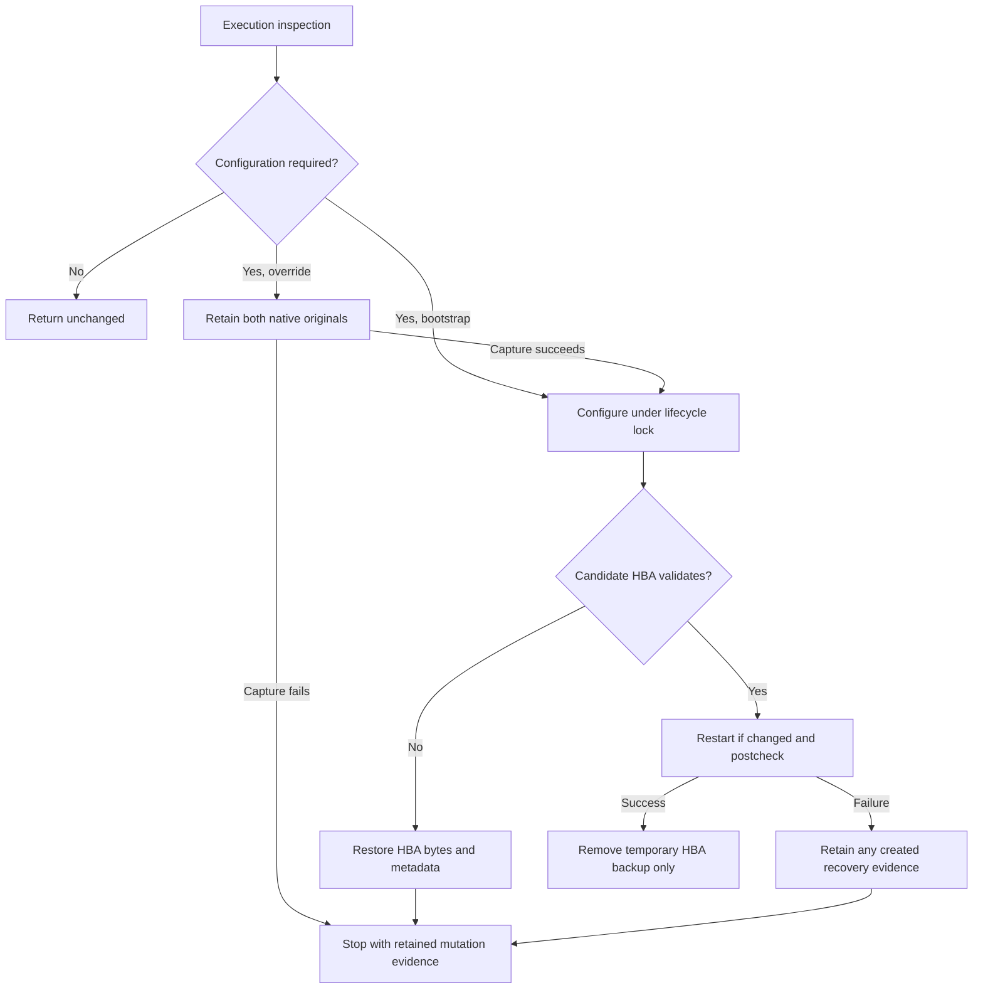

# PostgreSQL provisioning with operator-owned cluster configuration

Status: accepted, implemented design. The earlier shared-provisioning implementation completed bounded
native acceptance. Its host-side Python configuration replacement is locally verified, independently
reviewed and operator accepted, with no new native acceptance. Selected-cluster ownership, native
access proof, compatible adoption, reporting and explicit configuration override with retained
private backups and operator-controlled recovery remain accepted. Native and external-action
authority remain separate. Updated: 2026-10-31.
Workstream: `tas-lny6.4`, under `tas-lny6`. Design evidence baseline: `1f18ba74` on `operations/shared-host`.

## Purpose and decision inventory

By default, provision Taskman's own database resources on an existing PostgreSQL cluster without
replacing authentication, changing cluster settings, or interrupting other consumers. If the operator's
configuration cannot support the required connection, return a failure with actionable setup
context. Keep new dedicated-host installation supported and allow deliberate configuration
convergence through a targeted override with a visible blast radius.

| ID | Status | Decision | Downside or constraint | Contract |
| --- | --- | --- | --- | --- |
| D1 | Accepted | Sole-consumer status applies to the selected cluster; other clusters stay outside Taskman scope | A selected cluster still needs reliable identity proof | [Select one cluster](#select-one-cluster) |
| D2 | Accepted | Taskman owns isolated resources; operator owns shared configuration; unsuitable access requests operator setup | Provisioning cannot automatically repair shared authentication or listeners | [Installation ownership](#installation-ownership), [Operator setup context](#operator-setup-context) |
| D4 | Accepted | Retain configured PostgreSQL major-version selection and refuse ambiguous or missing targets among existing clusters | Multiple clusters within one track need operator resolution | [Select one cluster](#select-one-cluster) |
| D5 | Accepted | Prove application access using native SCRAM-required connections, without an HBA interpreter | Access can fail after new Taskman resources are created; requires a capable libpq client | [Prove actual access](#prove-actual-access) |
| D6 | Accepted | Adopt compatible partial resources without password rotation; retain ownership and data-provenance checks | Incompatible resources require operator repair rather than automatic normalization | [Resource adoption and interrupted setup](#resource-adoption-and-interrupted-setup) |
| D7 | Accepted | Extend existing provision authority and preview; retain existing commands and numeric categories | Internal projections and their consumers must change together | [Preview and authority](#preview-and-authority), [Failure results](#failure-results) |
| D10 | Accepted | `--force-postgresql-config` explicitly authorizes selected existing-cluster configuration convergence; every existing installation otherwise stays resource-only | Replacing HBA/settings or restarting can break other consumers; operator owns the decision | [Explicit configuration override](#explicit-configuration-override) |
| D11 | Accepted | Early PostgreSQL failures accept `manual / 5` and `refused / 10`; recognized failed checks remain independent | Does not reject a recognized check paired with an unexpected but internally consistent category | [Early failure receipt validation](#early-failure-receipt-validation) |
| D8 | Rejected | Per-invocation Taskman-only declaration plus broad corroborating checks | Substantial catalog/coordination logic still cannot independently exclude dormant consumers | [Why there is no sole-consumer detector](#why-there-is-no-sole-consumer-detector) |
| D3 | Superseded | Allow existing global convergence when Taskman is proven sole consumer | Reliable proof is too complex; strict absence-only D9 was considered before explicit override D10 | [Why there is no sole-consumer detector](#why-there-is-no-sole-consumer-detector) |
| D9 | Superseded | Allow global convergence only for initially absent PostgreSQL | Too restrictive for deliberate operator repair; D10 retains the safe default and adds explicit authority | [Explicit configuration override](#explicit-configuration-override) |

D1 was explicitly selected during resume. D2 was explicitly selected with the requirement that
PostgreSQL behave like shared Caddy: manage isolated parts and provide a clear failure when shared
configuration is unsuitable. D10 was explicitly agreed after rejecting complex sole-consumer
proof in favor of an operator-controlled override. D4 selection and D5 native SCRAM proof with retained resources after failure are accepted.
D6 compatible resource adoption, D7 preview/failure results and concrete D10 recovery mechanics
are accepted. D3/D9 preserve superseded alternatives and D8 preserves the rejected proof approach.
The separate [Python extraction decisions](#python-extraction-decisions) retain their original identifiers and scope.

## Evidence and inherited constraints

A supported shared installation can have unrelated consumers, multiple registered cluster tracks
and working operator-owned loopback authentication. Provisioning must preserve that configuration
and prove the selected endpoint rather than assume a dedicated server. Actual machine inventories,
role/database names and credentials are private deployment inputs; the
[inventory privacy policy](../inventories/operations-environments.md) governs their storage.

Listener verification accepts both loopback families. It does not require rewriting `localhost`
into a single literal address. Actual listener ownership and selected endpoint proof remain required.

Retain [operations contracts](2026-09-18-operations-contracts.md), particularly initial-install
admission, migration provenance, protected credentials, truthful mutation evidence, lifecycle
locking and bounded subprocesses. Retain the [simplicity policy](../guides/development.md#prefer-simplicity-within-the-supported-reliability-boundary)
and shared-Caddy completion semantics. Database failure must occur before application preparation,
migration or first-success publication; Caddy's proxy-pending exit 13 is not a PostgreSQL result.

Official PostgreSQL contracts used by this design:

- [HBA ordering and reload](https://www.postgresql.org/docs/18/auth-pg-hba-conf.html): the first
  matching rule decides authentication; failed authentication does not fall through. Includes are
  interpreted by PostgreSQL. Consequently, offering an appended line is not sufficient repair advice.
- [Required authentication](https://www.postgresql.org/docs/18/libpq-connect.html#LIBPQ-CONNECT-REQUIRE-AUTH)
  and [libpq environment variables](https://www.postgresql.org/docs/18/libpq-envars.html):
  `require_auth=scram-sha-256` requires a completed SCRAM exchange; `PGREQUIREAUTH` supplies it.
  [PostgreSQL 16 also documents this capability](https://www.postgresql.org/docs/16/libpq-connect.html#LIBPQ-CONNECT-REQUIRE-AUTH).
- [Password storage and method negotiation](https://www.postgresql.org/docs/18/auth-password.html):
  password creation uses the session's `password_encryption`; an HBA `md5` rule can negotiate SCRAM
  when the stored verifier is SCRAM. The design requires the actual exchange, not a literal HBA method.
- [psql password handling](https://www.postgresql.org/docs/18/sql-alterrole.html): `\password` avoids
  placing plaintext passwords in SQL command history or server logs.

These sources establish native behavior, not current-source integration or Taskman credential
access on production. Implementation and native acceptance must establish those separately.

## Observable behavior

| Situation | Provisioning behavior |
| --- | --- |
| Existing selected cluster, unrelated resources, working loopback SCRAM | Preserve all cluster settings/HBA and other resources; create or adopt Taskman's resources; prove access; continue existing provisioning |
| Existing Taskman-only cluster, no override | Resource-only ownership, even if current catalogs look dedicated |
| Existing cluster with `--force-postgresql-config` | Explicitly preview HBA/settings replacement and possible restart; converge only the selected cluster after confirmation and recovery capture |
| Override combined with unknown identity, foreign port ownership or contradictory Taskman resources | Refuse; the flag grants configuration authority, not a safety-check bypass |
| Existing selected cluster is down, on a different port, or exposes the configured port publicly | Refuse before host convergence; explain required running endpoint/topology; do not start or reconfigure it |
| Several candidate clusters, or other clusters exist but no requested-track candidate | Refuse selection; do not pick the first cluster or install another cluster automatically |
| PostgreSQL genuinely absent | Use the retained dedicated bootstrap; establish one selected cluster, then create/adopt resources and prove access |
| Taskman role/database missing, but shared HBA denies the eventual application connection | Retain newly created resources and private credentials; return failure with mutation evidence and operator setup context; do not migrate |
| Compatible role exists and database is missing | Preserve role/password, create the missing database, and prove access |
| Role is privileged/has memberships, or database has a different owner | Refuse resource adoption; preserve existing resources and credentials |
| Correct credentials supplied to a `trust` or non-SCRAM endpoint | SCRAM-required probe fails; do not accept a successful unauthenticated query as proof |
| Operator repairs shared access, then reruns `provision` | Rediscover and reconfirm; adopt compatible retained resources without password rotation; continue only after a fresh successful probe |

## Installation ownership

**D2 and D10 accepted.** By default, for an existing cluster manage only the configured Taskman role,
database and `/etc/taskman/pgpass` under their existing safety contracts. Runtime environment,
releases and scheduler retain their existing owners. Do not stage an HBA replacement, write an
HBA include or managed block, change global `password_encryption`, change listeners/port, modify
other roles/databases, or start/enable/reload/restart PostgreSQL. Preserve shared configuration
contents and metadata; package upgrades/installations are also excluded from this branch.

This applies on every existing-cluster invocation, including installations originally bootstrapped
by Taskman and clusters that currently appear Taskman-only. Existing compatible configuration
needs no manual action. Incompatible configuration receives the failure/setup context below.
Only the explicit [configuration override](#explicit-configuration-override) grants existing global
write authority; package installation history is not an ownership mechanism.

For genuine absence, retain the existing dedicated package installation and guarded native
configuration path. Require no registered clusters, no contradictory PostgreSQL service/data/config
authority, and no foreign listener at the intended endpoint. Missing inspection tools alone do not
prove absence. Existing PostgreSQL artifacts with no safely selected cluster request operator setup;
do not introduce automatic cluster creation, repair, version upgrades or deletion for those states.

Bootstrap can configure the new cluster's loopback settings and native HBA through the existing
validated path. A failure after installation retains actual partial state and mutation evidence.
A rerun observes an existing cluster and therefore uses resource-only ownership; if bootstrap left
its configuration unsuitable, the operator completes setup manually or deliberately uses the
configuration override after reviewing its preview. No bootstrap provenance marker grants later
authority. Other clusters are never changed.

## Explicit configuration override

**D10 accepted, including the recovery mechanics below.** Add the boolean
`--force-postgresql-config` only to `provision`; its invocation field is `force_postgresql_config`,
default false. It explicitly permits the existing dedicated configuration capability to converge
Taskman's native HBA and the selected cluster's `listen_addresses`, `port`, `password_encryption`
and native HBA-path setting. All existing identity/input/port/permission/native-validation checks
remain. It does not install/upgrade packages on an existing installation, choose another cluster,
rotate adopted passwords, alter foreign roles/databases, bypass migration provenance, reset data,
relax loopback safety, or override an unavailable/ambiguous observation.

With the flag, desired configuration is converged even if existing broader authentication already
permits Taskman. It is not a conditional fallback secretly enabled by a failed probe. Native
change detection avoids writes/restart when the target configuration is already exact. Otherwise,
the existing native path may restart that selected cluster; explicitly warn about interruption of
all its consumers and removal of authentication coverage for non-Taskman connections. Other
clusters remain outside authority. The flag is not a claim that the cluster is dedicated.

Present the selected version/name/data directory/port, each desired setting, the exact replacement
HBA policy, preserved resource scope, potential restart and recovery location before confirmation.
`--yes` confirms the displayed plan but never implies the flag. `--dry-run` previews the requested
override with no writes or proof of eventual success. Reject the flag on `deploy` and other commands
through ordinary argument validation. No environment ownership flag or package-installation marker
is added. On genuinely absent PostgreSQL, bootstrap is already authorized by its confirmed plan;
the flag grants no wider scope.

Before modifying an existing cluster under the override, retain protected recovery copies of only
the two native files the configuration capability can modify: its validated `postgresql.conf` and
native HBA, including original owner/group/mode and identity/digest. Use
`/etc/taskman/postgresql-config-recovery/<random-uuid>/` for each actual configuration change, under a root-owned non-link `0700` recovery parent, with `0700` run directories and `0600`
files `postgresql.conf`, `pg_hba.conf` and `metadata.json`. Metadata identifies the selected cluster,
original native paths, original uid/gid/mode and both SHA-256 digests. Keep copies on success and
failure and report their location; no automatic pruning or recovery-file overwrite. Do not create
a recovery run directory for an exact no-op. Retire copies only through separately authorized
operator cleanup after their recovery need is resolved. Retained private backups and manual recovery
are preferred over no retained copies, which reduces recoverability, or automatic whole-configuration
rollback, which adds restoration/state handling and another potentially disruptive restart.
Use the existing native safe-file and failure boundaries, not a generic snapshot/restore manager.
Do not export role/password catalogs or table data. Native configuration copies may themselves
contain operator secrets; retain them privately and suppress their contents in diagnostics.

Do not claim that the current native HBA failure rollback restores all cluster settings or runtime:
the existing path backs up/restores HBA only. Retain that scoped behavior and truthful failure
reporting; keep the additional original configuration copy available for deliberate operator
recovery. Restoring configuration and restarting/reloading remain separate consequential actions.
Do not automatically restore unrelated files or repair other consumers. Default shared provisioning
performs none of this write/recovery capture because it has no global configuration authority.

## Python extraction decisions

These accepted, implemented decisions preserve the identifiers from the completed native
configuration extraction. Their `Python` qualifier distinguishes them from ownership D1–D11 above.
The [operations contracts](2026-09-18-operations-contracts.md#postgresql-configuration-requests-and-results)
own exact wire and mutation semantics; the [runbook](../guides/deployment.md#explicit-postgresql-configuration-override-and-recovery)
owns operator recovery steps.

| ID | Status | Decision | Concrete cost | Rationale |
| --- | --- | --- | --- | --- |
| Python D1 | Accepted | Extract only native inspection/configuration for bootstrap and explicit override | Two helper operations and cancellation integration for a path default shared provisioning skips | [Extraction scope and alternatives](#extraction-scope-and-alternatives) |
| Python D2 | Accepted | Bind the frozen selected target and retain separate recovery capture | Capture/configure remain separate calls without whole-provision serialization | [Configuration and recovery procedure](#configuration-and-recovery-procedure) |
| Python D3 | Accepted | Reuse PostgreSQL modules without merging admission/configuration policies | Separate observation policies retain distinct bootstrap/live-port rules | [Native configuration architecture](#native-configuration-architecture) |
| Python D4 | Accepted | Keep bounded protocol-v3 failure projection and explicit mutation evidence | Narrow branches in dispatch, encoding and controller validation | [Internal failure and encoding](2026-09-18-operations-contracts.md#postgresql-internal-failure-and-encoding) |
| Python D5 | Accepted | PostgreSQL-first extraction using the transient helper, existing authenticated connection and inspect/configure boundary | Retains helper transport overhead | [Native configuration architecture](#native-configuration-architecture) |

### Extraction scope and alternatives

**Python D1 and D5 accepted.** Host Python owns cluster/runtime observation, desired-state
comparison, configuration sequencing, HBA backup/replacement/restoration and post-restart
validation. Pyinfra retains provisioning order and change reporting. The previous substantial
shell combined cluster/PID/SQL parsing, setting changes, candidate installation, traps and partial
recovery; Python gives that procedure direct state/failure tests. Default shared provisioning
skips this path, so the extraction is maintenance work rather than a provisioning prerequisite.

| Alternative | Benefit | Cost and disposition |
| --- | --- | --- |
| Keep generated shell | No new operation/schema/runner changes | Viable deferral; retains quoting/trap and indirect test complexity; extraction chosen instead |
| Extract only native inspection/configuration | Removes the substantial generated workflow while preserving provisioning ownership | Accepted; two closed operations and a small cancellation seam |
| Move all PostgreSQL provisioning into the helper | One location for resources and native configuration | Outside scope; unnecessary credential/admission/provisioning redesign |

Moving shell into a `.sh` file changes navigation only. A separate Python transport duplicates
transfer, authentication and result handling. Neither improves the chosen boundary. Revisit the
extraction if it requires a generic recovery/observer framework or materially more persistent state.

Package selection, root/configuration inputs, staged HBA content/mode, native topology, protected
resource convergence and final SCRAM-required application proof retain their existing owners.
Ready authority still authenticates; runtime validation is unconditional. Caddy, UFW, systemd,
release/builder/toolchain workflows, unrelated short shell commands, public CLI/error/output
contracts and dry-run semantics remain outside this extraction. There is no resident helper,
temporary PostgreSQL instance, alternate HBA path, configurable command/path escape hatch,
new controller/host dependency, generic workflow engine or blanket configuration rollback.

### Native configuration architecture

Paths below are relative to `ops/taskman_ops/`.

| Owner | Responsibility |
| --- | --- |
| `services/postgresql.py` | Plans, pyinfra declarations, protected database work and request/result integration |
| `host_helper/postgresql.py` | Admission observation and genuinely common parsing/native-command primitives |
| `host_helper/postgresql_configuration.py` | Native configuration observation, desired-state checks and the HBA procedure |
| `host_helper/operations/postgresql.py` | Narrow request validation, lifecycle lock, capability invocation and bounded final results |
| `host_helper/commands.py` | Opt-in PostgreSQL cancellation with unchanged defaults for existing consumers |
| `host_protocol/postgresql.py` | Exact configuration, authority and recovery request/result schemas |
| `host_helper/postgresql_recovery.py` | Protected capture and its separate failure projection |
| `workflows/helper.py` | Closed request/result validation, error mapping and transport-loss accounting |
| `host_protocol/operations.py`, `host_helper/__main__.py` | Exact operation names, dispatch validation and PostgreSQL-specific failure/encoding projection |
| `helper_client/package.py` | Transient-only configuration modules and scheduled-backup least authority |
| `provisioning.py` | Validated non-secret operation inputs and declaration/consequence order |

**Python D3 accepted.** Keep configuration in a focused sibling module: admission requires an already
configured endpoint and observes resources, whereas bootstrap configuration must inspect the old
live port before changing it. Do not call the full admission observer from configuration or weaken
admission to accommodate bootstrap. Reuse small parsing/native-query primitives only when their
contracts match; do not migrate unrelated admission policies or duplicate whole observers.

Small private dataclasses hold observed cluster identity and in-flight HBA restoration state.
Keep them local to PostgreSQL; do not add generic state machines or durable journals. Extract a
separate filesystem module only if the cohesive HBA transition becomes independently substantial.
Reuse `host_helper/commands.py` for bounded argv subprocess execution.

The pyinfra operation receives validated configuration alongside its plan. During execution its
inspection invokes the existing helper using a `PyinfraRemote` wrapping that same host/state.
If configuration is required, its `FunctionCommand` invokes configuration through the same
adapter. Do not call `run_deploy` recursively. No helper is invoked during prepare or dry-run.
Bootstrap packages and staged HBA must execute first. Resource-only existing plans never invoke
either configuration operation. Requests bind the selected target under the
[operations contract](2026-09-18-operations-contracts.md#postgresql-configuration-requests-and-results).
An unchanged inspection yields no mutation operation;
configuration always reobserves authority and never trusts an earlier inspection snapshot.

Keep pyinfra's existing execution-based change semantics. A converged inspection skips the
`FunctionCommand` and reports no change. Once yielded and executed, that command counts as
changed in pyinfra even if another actor converged state between inspection and configuration,
and the helper consequently reports `changed: false`. The helper boolean describes its own
mutation; it does not override pyinfra's completed-operation accounting. Accept this conservative
race result rather than mutating private operation metadata or running the mutation inside the
inspection generator merely to change accounting. This distinction is a regression obligation.

### Observation and native command semantics

The native configuration path retains its accepted selection checks; the stricter complete-inventory
admission parser remains authoritative for admission. Do not silently broaden supported cluster
states while sharing primitives. Select exactly one `pg_lsclusters --no-header` row in the requested
track (or across all tracks when unspecified). Validate numeric version/port, safe cluster name, online/down status,
and `postgres` owner. Refuse zero or multiple candidates. Do not simply choose the first row.

Read the data directory with `pg_conftool -s VERSION CLUSTER show data_directory`; retain its
absolute, canonical, restricted-path check. Validate native configuration directory and regular
non-link configuration/HBA files without changing parent metadata. Parse the eight-line
`postmaster.pid`, including PID, data directory, start epoch, live port, socket and ready status.
Require `pg_ctlcluster VERSION CLUSTER status` and cross-check live SQL port/data/parent-PID
identity. The third SQL value is `(regexp_match(pg_read_file('/proc/self/status'),
'^PPid:[[:space:]]+([0-9]+)$', 'm'))[1]`, compared with the first `postmaster.pid` line.
Continue validating the numeric start-epoch line locally, but do not compare it with rounded
`pg_postmaster_start_time()` SQL: native acceptance corrected that unreliable comparison.

Administrative SQL uses `runuser -u postgres -- psql --no-psqlrc --tuples-only --no-align
--field-separator | --host /var/run/postgresql --port LIVE_PORT --username postgres
--dbname=postgres --command SQL` as individual argv elements. Use the observed old live port
before restart and the desired port afterward. Verify `SHOW config_file`, `SHOW hba_file`, and
`SELECT error FROM pg_hba_file_rules WHERE error IS NOT NULL` against the exact selected cluster.
An unsuccessful query is never an empty successful result.

Inspect staged digest, final bytes and `postgres:postgres:0640` metadata, absence of the temporary sibling HBA recovery
material, configured settings, and native effective settings. Use the versioned `postgres`
binary with `--config-file=... -C SETTING` as postgres. Retain all four effective settings:
`hba_file`, `listen_addresses`, `port`, and `password_encryption`.

Retain `pg_conftool` for setting configuration. Python replaces only the narrowly recognized
unquoted `127.0.0.1` assignment emitted by that utility, preserving comments, other content and
file metadata. Do not normalize IPv6 or introduce a PostgreSQL configuration-file rewriter.

Use finite subprocess output and timeout limits through the existing runner. Give each helper
procedure a 600-second total budget, including a 5-second lock acquisition allowance and a
reserved 30-second bounded cleanup/restoration allowance; individual commands use at most
60 seconds and the remaining work budget. The existing 660-second transport allowance encloses
that budget. Signal handling must terminate/reap active command groups before bounded restoration;
do not leave a parser/restart child racing the restored file. `run_command` accepts an optional
cancellation event, defaulting to no cancellation. With that event supplied, bounded waiting must
notice cancellation, abort/reap the existing process group and join its I/O workers before raising
a fixed cancellation error. PostgreSQL's temporary HUP/INT/TERM handlers only set the event;
the procedure checks it between commands and enters bounded cleanup after runner termination.
Restore previous handlers on exit. Restoration uses its reserved deadline without the already-set
work cancellation event; repeated handled signals must not restart or interrupt restoration.
`CommandCancelled` proves direct-child reaping and completed pipe workers. A distinct
`CommandCleanupError` means command quiescence is unproven: inspection stops with unchanged
`manual / recovery_required / 10`; configuration retains its available mutation and HBA evidence,
uses `manual / recovery_required / 10`, and performs no automatic restoration or continuation.
This exceptional guard prevents restoration racing a possibly active native command; it does not
introduce a journal or change ordinary cancellation cleanup. The cost is one narrow exception
and capability branch; conservative refusal can require manual inspection even if the command
stops safely after the cleanup deadline.
Default calls retain their behavior. The optional cancellation seam is the only shared-runner
extension in this capability; cancellation and unchanged existing consumers remain regression obligations.

### Configuration and recovery procedure



Both operations use the existing lifecycle lock for coherent observation and configuration.
Baseline directories precede invocation; no outer lock is held across the helper call. Recheck
all authority under the configure lock. Do not claim that package installation or all provisioning
has become one transaction.

For `configure-existing`, retain the existing controller sequence: execution-time inspection skips
all capture/configuration for an exact no-op; otherwise `postgresql_config_recovery` succeeds
before the configure request. Its existing request, retained-copy format, reducer and error codes
stay unchanged. Bind capture and configuration to the same frozen target. Capture failure prevents
configuration. Preserve the known capture result separately on pyinfra state and in provisioning
results even if configure transport/encoding fails. Aggregate that persistent capture as changed.
Do not fold capture into configuration or add a token, journal, pruning or automatic restoration.
The existing capture/configure gap still requires coordinated operator maintenance; these calls
are not one transaction. A concurrent convergence can produce a retained copy followed by a
configure no-op. No capture is introduced for bootstrap or ordinary shared provisioning.

The [explicit override contract](#explicit-configuration-override) owns the persistent two-file
recovery format and custody. Only the temporary sibling HBA backup below is eligible for this
procedure's cleanup.

1. Prove a reachable online selected cluster, PID/SQL identity, native active config/HBA paths,
   current parser success, staged digest, and absence of the temporary sibling HBA recovery path (including symlinks). Retained
   UUID override recovery directories are expected and do not themselves block convergence.
2. Compare configuration and HBA bytes/metadata. Set only differing settings with `pg_conftool`,
   normalize the exact IPv4 assignment if necessary, and validate native effective settings.
   These configuration changes may survive later failure; there is no whole-file rollback.
3. If HBA replacement is needed, create the exact sibling `pg_hba.conf.taskman-backup` directory
   privately as root, mode `0700`. Preserve the old bytes in `pg_hba.conf`, mode `0600`, and old
   numeric `uid:gid:mode` plus newline in `metadata`, mode `0600`. Never overwrite existing evidence.
4. Create a sibling candidate, assign postgres ownership and mode `0640`, and atomically replace
   the native HBA. Query the existing live server's rules view before any reload/restart.
5. On parser rejection, query failure, or handled HUP/INT/TERM before successful validation,
   atomically restore the old bytes and metadata. Remove only owned temporary files and the
   completed restoration's backup. Restoration requires proven command cleanup as specified above;
   if cleanup is unproven or restoration fails, preserve available evidence and require manual recovery.
6. After candidate parser success, do not restore the old HBA automatically. Restart only when
   required. On restart or postcheck failure retain any HBA backup created by this invocation;
   that sibling blocks a later mutation until operator resolution. A settings-only change with
   already exact HBA creates no sibling backup or new durable refusal marker. Its failure still
   reports settings/runtime uncertainty and retains any override copies. Do not add a journal to
   force the HBA barrier onto settings-only failures. This preserves the earlier shell procedure's
   accepted behavior.
7. Reobserve runtime PID, desired port, SQL identity, native config/HBA paths, and parser success.
   Only then clean this invocation's temporary HBA recovery material and report success.

SIGKILL, power loss, or controller transport termination can bypass cleanup. The accepted live-path
disk window remains; Python does not eliminate it. Existing temporary sibling HBA recovery artifacts, even recognizable
ones, require manual inspection rather than automatic replay. Retain their current names/content
so runbook recovery remains applicable. Do not delete unrelated native or legacy-HBA residue.

### Native HBA rationale

Earlier bounded native acceptance established that
`hba_file` is startup-only and the rules view reads current disk contents. Source provenance is
the PostgreSQL 18 [file-location documentation](https://www.postgresql.org/docs/18/runtime-config-file-locations.html)
and [rules-view documentation](https://www.postgresql.org/docs/18/view-pg-hba-file-rules.html).
The two official documentation pages were rechecked on 2026-10-31; they still document
these properties. Those sources and earlier observations do not establish native acceptance of
the Python replacement.

## Why there is no sole-consumer detector

**D3/D9 superseded by D10; D8 rejected.** Reliable sole-consumer proof would need to distinguish
standard roles/databases from dormant application state, inspect objects in administrative/template
databases, check replication and jobs, bind a declaration to the selected cluster, and recheck
before restart. Even those checks could only disprove sole-consumer status: an external inactive
job using built-in or Taskman credentials need not leave distinguishable catalog state. Connection
counts are weaker still. An explicit operator assertion would remain essential.

The operator rejected disproportionate verification machinery and selected a specific force flag.
The final approach therefore grants authority explicitly rather than pretending to establish sole
use. A package-origin marker would add persisted state without proving present ownership; default
resource-only behavior instead applies to every existing installation. Automatic global repair is
less convenient, but deliberate repair remains available with a visible blast radius. Reconsider
unattended inferred ownership only with an independently accepted consumer-inventory contract.

## Select one cluster

**D1 and D4 accepted.** Keep existing environment inputs `postgres_package_track`,
`database_host` (`127.0.0.1` or `::1`), `database_port`, `database_role` and `database_name`.
Do not add cluster aliases, ownership profiles, a sole-consumer declaration flag or a durable mode flag.
The D10 configuration override supplies mutation authority after selection; it does not select a cluster.

Inspect registered Ubuntu clusters, applying the optional package-track filter, and require one
candidate. Bind its version, name, data directory, configured/live port and trusted native process
identity. Require administrator access as `postgres` through `/var/run/postgresql` at the configured
port; never query whichever cluster happens to use the default port. Existing selected clusters
must already be online at the requested port. Bind the database listener to that cluster and require
all listeners on the configured database port to be loopback-only, preserving dedicated-host safety.

Different-track clusters do not invalidate a uniquely selected existing candidate and are excluded
from mutation. No selected candidate while other clusters exist is an operator-setup refusal, not
an absent-installation bootstrap. With no track supplied, multiple clusters refuse. On the observed
production topology, track `18` would select `18/main`; this does not choose or publish production
environment values. An exact version/name input would cover more complex same-track hosts but
adds configuration and selection behavior unnecessary for the observed deployment; reconsider only
when such a host needs support.

## Prove actual access

**D5 accepted.** Use native connection proof instead of parsing or reimplementing HBA matching.
Inspect known prerequisites before convergence: selected live endpoint, administrator access,
listener safety, resource compatibility and a client capable of `require_auth`. A client without
that capability refuses; never silently omit the requirement. Unsupported-client diagnosis must
identify the prerequisite separately from a failed application connection. On genuinely absent
bootstrap, check this capability after client-package installation and before resource creation.

For existing resources, default shared provisioning proves application authentication during
admission as well as after convergence. The explicit configuration branch instead uses selected-cluster
administrator catalog/schema observations before configuration and reports application access as
unproven. It defers only application authentication until immediately after configuration/resource
convergence and credential installation; no preparation or migration can cross that proof boundary.
Retain protected credential-file ownership/mode and exact-byte authority checks, role/database
compatibility, empty-schema or migration-provenance proof, and all other admission checks before
confirmation. The flag cannot turn an unknown catalog/schema state into admission authority.
This exception is necessary because an HBA repair must not be blocked by the application connection
it is intended to repair; it does not permit credential rotation or a generic validation bypass.

Carry selected-track and override context through every provision-mode discovery, target resolution,
deployment admission, downgrade-authority observation, credential preflight and post-confirmation
refresh. All use the same privileged selected-cluster observation rather than independently selecting
a default endpoint. Existing target resolution occurs before capability preflight, so changing only
resource convergence or the later `provision_authority` call would leave the override unreachable.

For a new role, prepend `SET LOCAL password_encryption = 'scram-sha-256';` within the existing
transaction before `\password`. Keep secret input on suppressed sensitive stdin. This confines
password creation policy to Taskman's session and does not change cluster defaults. Preserve an
existing role's password/verifier; a legacy verifier requiring rotation is operator work.

After role/database convergence and protected credential installation, connect using explicit
host, port, role and database with `PGPASSFILE=/etc/taskman/pgpass`,
an explicit libpq `require_auth=scram-sha-256` connection parameter, `--no-psqlrc`,
`--no-password` and `ON_ERROR_STOP=1`. Use a non-secret conninfo value such as
`--dbname "dbname=taskman_prod require_auth=scram-sha-256"` with the validated database
identifier and separate explicit host/port/user flags. Unsupported clients reject that parameter;
do not rely only on an environment variable an older client could ignore.
Run a bounded read-only identity query proving `current_user`, `current_database()`,
`inet_server_addr()` and `inet_server_port()` match the request. Require successful native status
and the exact validated response. Suppress native diagnostics; do not expose password material or
parse localized error strings to infer the cause. Use the existing remote/host subprocess bounds
and secret-safe environment handling; do not use `PGPASSWORD`.

When admission has supplied credentials but no retained protected passfile, replace the current
`PGPASSWORD` preflight with a bounded root-only transient passfile inside the existing private helper
workspace. Use `PGPASSFILE` and remove the temporary file on success, failure and timeout through
existing cleanup boundaries. When the retained file exists, validate its metadata and exact bytes
before using it. Deferred configuration admission does not perform this application probe or need
its temporary passfile; it still checks any retained credential authority. Secrets remain suppressed
stdin/file material, never argv, diagnostic output or password environment variables.

Apply the same authentication requirement to existing shared application-credential database
observations used by provisioning and subsequent lifecycle operations. Administrator catalog
queries remain explicit socket/port peer-authenticated queries. Runtime Phoenix access remains
verified through existing application readiness; the libpq option is not a Postgrex configuration
setting or proof that every future connection will use unchanged authentication.

Real proof can only occur after missing resources exist. Avoid a temporary probe role/database,
synthetic password, negative-password matrix or HBA evaluator solely to fail earlier. The accepted
cost is that a refused application connection can leave valid new Taskman resources behind.
Bootstrap and shared tests must distinguish SCRAM success from `trust`, plaintext, legacy MD5,
denied access, wrong credentials and unsupported native clients.

## Resource adoption and interrupted setup

**D6 accepted; failure retention accepted under D5.** Retain the existing least-authority role attributes: LOGIN, INHERIT,
NOSUPERUSER, NOCREATEDB, NOCREATEROLE, NOREPLICATION, NOBYPASSRLS and no explicit parent memberships.
The configured database must have that role as owner. Do not rotate passwords, normalize
privileges, drop/recreate databases or change unrelated grants to make an existing resource fit.
Configured names plus validated state and the displayed confirmation supply adoption authority;
no new creation-provenance marker is required.

Support both resources missing, compatible role-only, and compatible role/database. Database
without the expected role, contradictory attributes/memberships/owner, and unknown inspection
refuse. Extend the preconvergence observer to recognize compatible role-only state as an incomplete
planned resource delta rather than declaring the database ready. Preserve empty-database proof and
populated-database migration provenance; ownership alone does not authorize adopting foreign data.

A compatible precreated Taskman database does not by itself require an existing Taskman OS account.
Permit the missing account as a planned baseline creation only after the selected role/database
compatibility and empty-schema or accepted migration-provenance evidence are established. Feed that
evidence into host acceptance before its current existing-database/missing-account refusal. Matching
names or owner alone are insufficient; other filesystem, service and account admission constraints
remain. This explicitly extends the current cross-service partial-state rule rather than silently
claiming all compatible database adoption already works.

Known contradictions refuse before protected credential writes. Missing resources may be created
only after confirmation. If later connection verification fails, preserve created resources,
credential files and earlier provisioning changes, and stop before release preparation/migration.
Do not undo earlier Caddy/systemd changes or drop a role/database automatically. Retry uses ordinary
`provision` discovery and confirmation. The configuration override does not bypass resource
adoption or data-safety checks; no PostgreSQL pending-completion mode is added.
Transport loss retains possible mutation, not a fabricated unchanged result.

## Preview and authority

**D7 accepted.** Add PostgreSQL ownership/access context to the existing redacted `provision`
preview and structured failure result. Show selected cluster or bootstrap intent, endpoint,
role/database creation versus adoption, configuration ownership and explicit override state,
the required SCRAM probe and its potentially post-creation failure boundary. Dry run remains `0/planned`; it cannot claim
application credential proof for resources it did not create.

Extend the existing `provision_authority` inspection/projection with a closed PostgreSQL observation
and build a frozen ownership plan for `ProvisioningInputs`. The privileged observation owns live
cluster/resource discovery; the controller validates request binding and required fields rather
than rediscovering the same state. Keep discovery and execution branches consistent.

The provision-mode ordinary discovery request and `provision_authority` request both carry the
configured `postgres_package_track` and required boolean `force_postgresql_config`; other discovery
modes retain their own closed request schemas. Do not coerce strings or missing booleans into
authority. The existing successful projection adds a closed `postgresql` object with exactly
`branch`, `cluster`, `role`, `database` and `access`:

- `branch`: `bootstrap`, `existing` or `configure-existing`, derived from proven absence/presence
  and the explicit request flag; no caller-supplied branch bypasses inspection.
- `cluster`: null only for bootstrap, otherwise a closed object with `version`, `name`,
  `data_directory`, `config_file`, `hba_file` and integer `port`. Validate native identity and safe
  paths before returning them. Process/listener checks remain internal observation evidence;
  physical target drift must invalidate the frozen plan.
- `role` and `database`: each `absent` or `compatible`; contradictory/unknown resources return
  a failed operation rather than successful authority with another state. Compatible role-only
  state has `role=compatible`, `database=absent`; never invent ready database/schema facts.

- `access`: `unproven` or `ready`; `ready` requires the native application SCRAM/identity proof.
  Bootstrap, missing resources and deferred configuration admission report `unproven`. Catalog/schema
  readiness alone cannot produce `ready` or an overall healthy application-access claim.

Top-level database/schema authority still describes inspected resources and provenance; it must not
be interpreted as application connectivity. Human and JSON previews expose the separate access
state, and action consumers require the successful post-convergence proof before preparation or
migration. The sensitive credential-preflight request uses two closed authentication modes,
`authenticate` and `defer-for-configuration`; the latter is derived only from validated override and
selected-cluster context, never an unconstrained skip-validation input. Owned resource observations, relevant credentials and initial
schema/provenance evidence must be consistent with the existing authority snapshot. Update both
closed producers/validators and all consumers together; no generic extra-key acceptance or legacy
shim is required for these internal, repository-owned consumers.

Revalidate the selected identity, ownership branch and relevant role/database authority after
confirmation and before their consequence. Refuse unexplained target/resource drift and replan.
Do not require global HBA/config byte equality when the operation has no authority to write those
files. The explicit configuration branch instead retains native-file drift/safety checks and
the recovery capture described under D10. The fresh native access proof handles ordinary operator
configuration changes. Preserve the existing lifecycle lock and supported operator-coordination
boundary; no global PostgreSQL lock, configuration fingerprint registry or perpetual monitor is
introduced. Explicit global convergence needs a coordinated configuration/maintenance window,
not an inferred absence of other consumers.

## Failure results

Keep `OpsError` and existing numeric categories:

| Condition | Status / stage | Required result |
| --- | --- | --- |
| Invalid environment | `2`, existing input stage | Existing validation failure |
| Missing/ambiguous selected target, unsafe listener, contradictory role/database, unsafe recovery capture or confirmation drift | `10 / postgresql` | Name the refused boundary and operator setup/replan action |
| Administrator/native inspection unavailable, unsupported client, or actual application connection proof fails | `5 / postgresql` | Name the failed check and required access; preserve uncertainty about its cause |
| Bootstrap package/native convergence fails | Existing classified category; never success/pending | Retain actual known/possible changes and existing installation recovery directions |

The result must retain aggregate mutation state and prior successful provisioning evidence through
dispatch, transport failure and output encoding. `changed=false` is valid only if no earlier or
attempted persistent action warrants changed/unknown evidence. Database access failure cannot
publish a successful selection, migration proof or proxy-pending result. Do not add another exit
code or make all database failures `10` merely because operator intervention is required.

### Early failure receipt validation

For unsuccessful `provision_authority` and provision-mode `discover` results declaring
`failed_boundary=postgresql`, validate classification in
`host_protocol/postgresql.py:validate_postgresql_failure_context` after envelope
correlation in `workflows/helper.py:run_request`. Require a string outcome and an
exact integer exit code with only these accepted pairs:

| Outcome | Exit code / public status |
| --- | --- |
| `manual` | 5 |
| `refused` | 10 |

**D11 accepted.** Independently require a string failed-check name from
`scram-client-prerequisite`, `scram-application-access`, `schema-inspection`,
`resource-schema-consistency` or `selected-target-or-resource-safety`. Any recognized
name may accompany either pair; `manual / 5 / resource-schema-consistency` is valid.
A producer-matching check/category matrix was rejected because it duplicates producer
policy without a demonstrated additional guarantee. Revisit only if such a mismatch
causes a material failure that pair validation cannot prevent. Preserve the producer's
established `manual / 5` classification rather than changing it to `retryable / 5`.

State remains exactly `failed_boundary`, `exit_code`, `failed_check` and
`postgresql_observation`. Preserve request-bound observation validation and nullable
observations; absence proves neither cluster identity nor completed checks. Valid
results retain bounded observation/check state and warnings through public mapping.
Reject invalid pairs, unknown checks and malformed field types with
`ProtocolError("invalid PostgreSQL failure context")`. The controller reports status
10, request-operation stage, message `host helper returned invalid PostgreSQL failure context`,
empty state and `changed=False`, retaining bounded warnings and inspection guidance.
Do not import invalid observations/raw diagnostics or continue provisioning. Preserve
aggregate mutation evidence from any earlier controller preparation.

This policy stays specific to early PostgreSQL failures; generic envelope decoding,
public error precedence, successful authority, other discovery modes, recovery capture
and lifecycle mutation schemas keep their existing contracts. A synthetic wire-level
experiment reproduced acceptance of `refused / 5` (misreported as status 10) and
`retryable / 10` before the fix; it involved no host connection or mutation.

Validator tests cover both pairs against every recognized check, malformed types and
nullable observations. Wire-level controller regressions cover both operations, safe
rejection, valid evidence and retained selection validation. Focused boundary/isolated
packaging checks passed (318 passed, one opt-in native PostgreSQL skip); full operations
and application precommit gates passed, independent scoped review found no issues,
and the operator accepted the result. Repository-relative Task 37, exact description
marker `Source: taskman/br/tas-lny6.4.7`, owns detailed evidence. This validation-only
correction requires no new native acceptance or application release build and does
not extend the earlier bounded native evidence.

## Operator setup context

Human and JSON output must provide the configured endpoint, selected version/name when proven,
role/database names, the failed check, the observed native HBA path when available, preserved
resource/mutation facts, and the exact retry command `./ops/taskman provision ENV` with the actual
validated environment name. Never expose credential bytes, SQL password statements, native
stderr, raw configuration contents or unproven diagnoses.

For a failed access probe, say that the required SCRAM-authenticated connection could not be
established and that either access configuration or existing credentials may need correction.
Offer this target-specific HBA example for operator review, replacing all values from validated
configuration:

```text
host    taskman_prod    taskman    127.0.0.1/32    scram-sha-256
```

The names above are examples, not approved production values. For `::1`, use `::1/128`. Explain
that the operator must place effective coverage before conflicting matching rules, inspect
`pg_hba_file_rules` for parser errors, and reload only the selected cluster after their own changes.
Existing broader rules can already suffice; do not instruct the operator to add a duplicate blindly.
Listener/port changes can require a restart; default shared provisioning does not perform it.
The explicit override retains the selected-cluster restart behavior described under D10.
Password mismatch/verifier repair is distinct from HBA setup; recheck independent protected
credentials rather than changing an adopted role automatically. Mention `--force-postgresql-config`
as an explicit alternative only with its full-config/restart warning; never recommend it as a
generic way to overcome an unknown failure. The operator must decide that replacing the selected
cluster configuration is appropriate and arrange other consumers/recovery first.

Example human failure with newly created resources:

```text
PostgreSQL access verification failed (exit 5).
Required: SCRAM connection to 127.0.0.1:5432 as taskman, database taskman_prod.
Selected cluster: 18/main. Authentication configuration: /etc/postgresql/18/main/pg_hba.conf.
Taskman role/database and protected credentials were created and retained; no migration ran.
Check effective HBA ordering and the configured credentials. Shared configuration was preserved.
After operator setup, rerun: ./ops/taskman provision production
```

Only report the created/retained and no-migration facts when established; lost replies must instead
state uncertainty. This is a clear failed operation with recovery directions, not a successful
installation awaiting proxy activation.

## Implementation boundaries and verification

Source owners:

- `services/postgresql.py`: frozen desired/ownership plan, existing/absent/explicit-configuration
  branches, protected override recovery capture, resource convergence, session-local password
  creation and native application access proof.
- `host_helper/operations/discover.py` and focused shared helper capability if needed: selected
  cluster/resource observations and compatible partial-resource admission. Keep substantial new
  workflow logic in Python; native configuration has the [focused owners above](#native-configuration-architecture).
- `host/facts.py`, `host/acceptance.py`, `provisioning.py`, `workflows/provision.py`: consistent
  PostgreSQL admission, compatible database/missing-account admission, configured endpoint queries,
  plan binding, preview and failure propagation. Include `workflows/deploy.py` and shared discovery
  request builders because provision target resolution uses their admission path.
- `host_helper/operations/preflight.py`, credential helpers and `helper_client/runner.py`: closed
  deferred-authentication contract, preserved file authority and transient-passfile cleanup.
- `host_helper/database.py`, relevant verification prerequisite and closed protocol validators:
  common authenticated application queries and correctly selected admin endpoint.
- `cli.py`: provision-only boolean flag parsing, invocation transport and help. The operations CLI
  currently has no Bash/Fish completion artifact; application CLI completions are a separate surface.
- Existing PostgreSQL/discovery/provision/verification tests, runbook, CLI help and
  `priv/taskman_ops_skill/SKILL.md`: behavior and command-surface parity.

Verify distinct consequential cases in focused tests before the full gates: untouched shared
configuration/packages/service and unrelated resources; selected 18 plus retained 16; absent versus
missing-target/partial installation; compatible role-only retry and validated precreated database with missing OS account;
wrong owner/privilege/provenance refusal; override reaching preview through all admission paths
with failed application authentication, retained credential authority and explicit unproven access;
transient credential-passfile cleanup on success/failure/timeout;
session-local SCRAM with a different cluster default; successful SCRAM and refused weaker/denied
connections; correct identity/port and unsupported client; existing Taskman-only clusters staying
resource-only by default; explicit override scope, recovery bytes/metadata, no-op, failed convergence
and selected-cluster restart; flag/yes/dry-run/argument-validation parity and target drift refusal;
known/possible mutation retention and human/JSON setup context; no migration/first-success
publication after failure. Reuse existing provenance, resource fixtures and meaningful lifecycle coverage rather than duplicating every case.

Native configuration regression obligations additionally cover zero/multiple/malformed clusters,
stopped/unreachable servers, PID/SQL/path contradictions, parser availability, default/custom ports,
old-port to desired-port transitions, staged digest/metadata drift, unchanged native parent metadata,
IPv4 normalization with IPv6 preservation, recovery-residue refusal, exact HBA restoration on parser
failure/handled signals, restart/postcheck evidence retention, settings-only failure without a new
marker, failed restoration and unproven command cleanup. Programmatic pyinfra coverage distinguishes
prepare/dry-run, first change, converged skip and the executed configure-no-op race. Both deterministic
zipapps execute under `python3 -I -S`; configuration capabilities remain transient-only. Architecture
guards have no PostgreSQL substantial-shell exemption. The exact helper/encoding regression obligations
belong to the [operations contracts](2026-09-18-operations-contracts.md#postgresql-configuration-verification).

The Python replacement's full local gate on 2026-10-31 passed: locked dependency sync, Python
`compileall`, four-worker operations suite (2,795 passed, 22 environment/opt-in skips), shell syntax
and `mix precommit` (1,398 passed, three opt-in executable skips, 51 browser exclusions). Real handled
signals, command cleanup, isolated helper archives, strict results and pyinfra paths are locally
covered with synthetic native boundaries. Scoped independent review found no outstanding findings;
the completed replacement and test-support extractions are operator accepted.

Use the repository operations, compile/shell and `mix precommit` gates for future implementation changes.
Native acceptance must use a separately approved disposable-host scope with a sibling database,
preservation/health evidence, operator-setup/retry proof, and a separately authorized explicit
override/no-op/failure-recovery case on a disposable cluster. The ordinary shared case must not
use the override to make its preservation checks pass. Native commands must establish actual
authentication, package/service behavior and preservation; mocks alone do not establish these.
No whole-database row fingerprinting is required for ordinary provisioning verification. Production
inspection here is read-only evidence, not a native provisioning acceptance test.

## Implementation outcome and authorization

The written design decisions and configuration recovery trade-offs are accepted and implemented.
Bounded native acceptance applies to the earlier shared-provisioning implementation; actual host
results remain in private operator records. The subsequent host-side Python configuration replacement
is locally verified, independently reviewed and operator accepted. It has no new PostgreSQL/systemd
host acceptance: local fakes and subprocess tests do not prove native behavior. A separately
authorized supported-host check must establish native parsing/ownership, first and second convergence
and custom-port behavior for that replacement. Failure injection, port changes and restart are not
authorized merely to satisfy its regression matrix. The [native acceptance guide](../guides/native-acceptance.md) owns portable
verification criteria and limits.

Future provisioning, native tests, shared PostgreSQL restart/reload, fixture deletion, pushing,
merging and publication require separate authorization. Accepted results do not establish safety
or authentication on a different target or renew authority for another host action.
